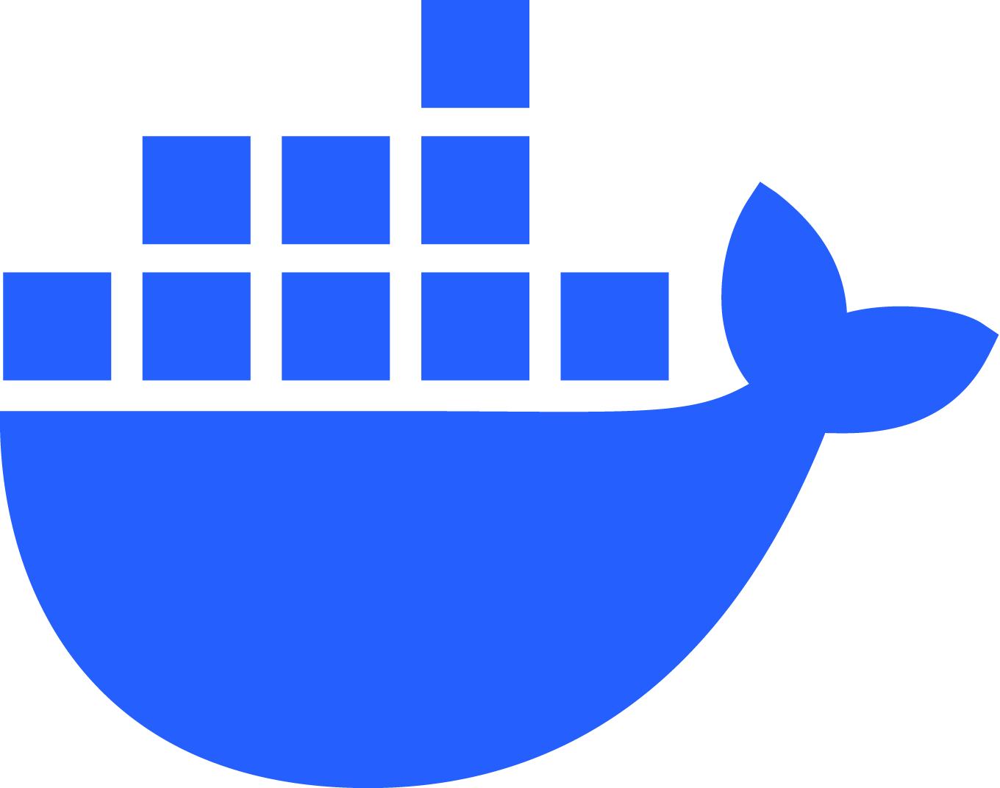

# Docker y Docker Compose

<p align="center">
  
</p>

> Guía de referencia sobre Docker y Docker Compose: conceptos, arquitectura, comandos, buenas prácticas, seguridad y ejemplos prácticos en cada sección.
> Usa la sintaxis moderna: `docker compose` (Compose v2), BuildKit como motor de build y `compose.yaml` como nombre de fichero.
> Cada parte termina con un **ejemplo completo y sencillo** que pone en práctica lo visto en ella. Los tres ejemplos usan la misma aplicación (un contador de visitas en Python con Redis): primero solo con Docker, después con Docker Compose y, por último, en un flujo completo del código a producción.

---

## Índice

**Parte I — Docker**

1. [Introducción a Docker](#1-introducción-a-docker)
2. [Arquitectura](#2-arquitectura)
3. [Instalación y primeros pasos](#3-instalación-y-primeros-pasos)
4. [Imágenes](#4-imágenes)
5. [Dockerfile](#5-dockerfile)
6. [Construcción de imágenes (build)](#6-construcción-de-imágenes-build)
7. [Contenedores](#7-contenedores)
8. [Redes](#8-redes)
9. [Almacenamiento: volúmenes, bind mounts y tmpfs](#9-almacenamiento-volúmenes-bind-mounts-y-tmpfs)
10. [Configuración y variables de entorno](#10-configuración-y-variables-de-entorno)
11. [Registros de imágenes](#11-registros-de-imágenes)
12. [Limitación de recursos](#12-limitación-de-recursos)
13. [Seguridad](#13-seguridad)
14. [Logs, mantenimiento y limpieza](#14-logs-mantenimiento-y-limpieza)
15. [Resolución de problemas](#15-resolución-de-problemas)

Ejemplo final: [Ejemplo completo (Parte I): contador de visitas con Docker](#ejemplo-completo-parte-i-contador-de-visitas-con-docker)

**Parte II — Docker Compose**

16. [Introducción a Docker Compose](#16-introducción-a-docker-compose)
17. [Estructura del fichero compose.yaml](#17-estructura-del-fichero-composeyaml)
18. [Servicios](#18-servicios)
19. [Dependencias y healthchecks](#19-dependencias-y-healthchecks)
20. [Redes en Compose](#20-redes-en-compose)
21. [Volúmenes en Compose](#21-volúmenes-en-compose)
22. [Variables e interpolación](#22-variables-e-interpolación)
23. [Secrets y configs](#23-secrets-y-configs)
24. [Perfiles (profiles)](#24-perfiles-profiles)
25. [Múltiples ficheros: override, include y extends](#25-múltiples-ficheros-override-include-y-extends)
26. [Fragmentos reutilizables: extensiones y anclas YAML](#26-fragmentos-reutilizables-extensiones-y-anclas-yaml)
27. [Escalado y recursos](#27-escalado-y-recursos)
28. [Desarrollo con Compose Watch](#28-desarrollo-con-compose-watch)
29. [CLI de Docker Compose](#29-cli-de-docker-compose)
30. [Ejemplo avanzado: Spring Boot + PostgreSQL + Angular/Nginx](#30-ejemplo-avanzado-spring-boot--postgresql--angularnginx)

Ejemplo final: [Ejemplo completo (Parte II): contador de visitas con Docker Compose](#ejemplo-completo-parte-ii-contador-de-visitas-con-docker-compose)

**Parte III — Referencia**

31. [Buenas prácticas](#31-buenas-prácticas)
32. [Más allá de Compose](#32-más-allá-de-compose)
33. [Chuleta rápida](#33-chuleta-rápida)
34. [Glosario](#34-glosario)

Ejemplo final: [Ejemplo completo (Parte III): del código a producción](#ejemplo-completo-parte-iii-del-código-a-producción)

---

# Parte I — Docker

## 1. Introducción a Docker

### 1.1 ¿Qué es Docker?

**Docker** es una plataforma para **empaquetar, distribuir y ejecutar aplicaciones en contenedores**. Un contenedor agrupa la aplicación con todo lo que necesita para funcionar (runtime, librerías, dependencias del sistema y configuración). Así se ejecuta igual en el portátil del desarrollador, en el servidor de CI y en producción.

Problemas que resuelve:

- **"En mi máquina funciona"**: el entorno viaja con la aplicación.
- **Aislamiento**: varias aplicaciones con dependencias incompatibles (p. ej. Java 17 y Java 21) conviven en el mismo host.
- **Despliegues reproducibles e inmutables**: la misma imagen pasa de desarrollo a producción.
- **Densidad y velocidad**: los contenedores arrancan en milisegundos o segundos y consumen mucho menos que una VM.
- **Base de la nube nativa**: Kubernetes, ECS, Cloud Run, Azure Container Apps, etc. ejecutan imágenes de contenedor.

### 1.2 Contenedores vs. máquinas virtuales

| Aspecto | Máquina virtual | Contenedor |
|---|---|---|
| Virtualiza | Hardware (hipervisor) | Sistema operativo (kernel compartido) |
| Sistema operativo | Un SO invitado completo por VM | Comparte el kernel del host |
| Tamaño típico | GB | MB |
| Arranque | Minutos | Milisegundos o segundos |
| Aislamiento | Muy fuerte (frontera de hardware) | Fuerte, pero comparte kernel |
| Densidad | Decenas por host | Cientos o miles por host |
| Caso de uso | SO distintos, aislamiento máximo | Microservicios, CI/CD, entornos reproducibles |

> En macOS y Windows, Docker Desktop ejecuta una VM Linux ligera de forma transparente, porque los contenedores Linux necesitan un kernel Linux.

### 1.3 Cómo funciona por dentro

Un contenedor **no es una VM**: es un **proceso normal del host** aislado con funcionalidades del kernel Linux.

| Mecanismo | Función |
|---|---|
| **Namespaces** | Aíslan lo que el proceso *ve*: `pid` (procesos), `net` (red), `mnt` (sistema de ficheros), `uts` (hostname), `ipc`, `user` (UIDs), `cgroup` |
| **cgroups (v2)** | Limitan lo que el proceso *consume*: CPU, memoria, I/O, número de PIDs |
| **Union filesystem (overlay2)** | Apila capas de solo lectura de la imagen y añade una capa de escritura por contenedor |
| **Capabilities, seccomp, AppArmor/SELinux** | Restringen qué puede hacer el proceso (llamadas al sistema, privilegios) |

**Ejemplo: comprobar el aislamiento**

```bash
# Namespace de PID: dentro del contenedor solo existe su propio árbol de procesos
docker run --rm alpine ps aux
# PID   USER     TIME  COMMAND
#     1 root      0:00 ps aux

# cgroups: el límite de memoria se ve desde dentro
docker run --rm --memory=64m alpine cat /sys/fs/cgroup/memory.max
# 67108864   (64 MiB)

# Namespace UTS: hostname propio
docker run --rm --hostname mi-contenedor alpine hostname
# mi-contenedor
```

---

## 2. Arquitectura

```text
+--------------------------------------------------+
| 1. Docker CLI  (comando "docker")                |
|    Lo que escribes en la terminal.               |
|    Solo envía peticiones; no ejecuta nada.       |
+--------------------------------------------------+
                         |
                         |   API REST (socket /var/run/docker.sock)
                         v
+--------------------------------------------------+
| 2. Docker Engine  (daemon "dockerd")             |
|    El "cerebro": gestiona imágenes, redes,       |
|    volúmenes y builds (con BuildKit).            |
|    Descarga imágenes del registro.               |
+--------------------------------------------------+
                         |
                         |   le pide que arranque el contenedor
                         v
+--------------------------------------------------+
| 3. containerd                                    |
|    Gestiona el ciclo de vida de los              |
|    contenedores (crear, parar, borrar).          |
+--------------------------------------------------+
                         |
                         |   para cada contenedor
                         v
+--------------------------------------------------+
| 4. runc                                          |
|    Crea el proceso aislado con                   |
|    namespaces y cgroups, y se retira.            |
+--------------------------------------------------+
                         |
                         |   resultado
                         v
+--------------------------------------------------+
| 5. Contenedor                                    |
|    Un proceso normal del host, aislado.          |
+--------------------------------------------------+
```

**De dónde salen las imágenes:**

```text
Registro (Docker Hub, GHCR...)  --pull-->  Docker Engine  --crea-->  Contenedor
Docker Engine  --push-->  Registro (Docker Hub, GHCR...)
```

**Qué ocurre, paso a paso, al ejecutar `docker run -d -p 8080:80 nginx`:**

1. La **CLI** traduce el comando a una petición HTTP y la envía al daemon por el socket.
2. **dockerd** busca la imagen `nginx:latest` en local. Si no la tiene, la descarga del **registro** (Docker Hub).
3. **dockerd** prepara la red (puerto 8080 del host hacia el 80 del contenedor) y el sistema de ficheros por capas.
4. **dockerd** pide a **containerd** que cree y arranque el contenedor.
5. **containerd** usa **runc** para crear el proceso con sus namespaces y cgroups. runc termina y el proceso queda vigilado por un pequeño proceso intermedio (*containerd-shim*).
6. El **contenedor** (Nginx) ya está en marcha. La CLI muestra su ID y te devuelve el control.

En el día a día solo tratas con la **CLI** (o con Compose); el resto de piezas trabaja por debajo.

| Componente | Descripción |
|---|---|
| **Docker CLI** (`docker`) | Cliente de línea de comandos. Habla con el daemon mediante una API REST |
| **Docker Engine** (`dockerd`) | Daemon que gestiona imágenes, contenedores, redes, volúmenes y builds |
| **containerd** | Runtime de alto nivel (proyecto de la CNCF): descarga imágenes y gestiona el ciclo de vida |
| **runc** | Runtime de bajo nivel conforme a OCI: crea el proceso con namespaces y cgroups |
| **BuildKit** | Motor de construcción de imágenes (por defecto desde Docker 23) |
| **Registry** | Almacén remoto de imágenes (Docker Hub, GitHub Container Registry, Amazon ECR, Harbor…) |
| **Docker Desktop** | Aplicación para macOS/Windows/Linux que incluye Engine, CLI, Compose, BuildKit y una GUI |

**Estándares OCI (Open Container Initiative)**: `image-spec` (formato de imagen), `runtime-spec` (cómo ejecutarla) y `distribution-spec` (cómo distribuirla). Gracias a ellos, una imagen construida con Docker funciona en Podman, containerd o Kubernetes.

**Ejemplo: inspeccionar la instalación**

```bash
docker version            # versión de cliente y servidor (Engine, containerd, runc)
docker info               # drivers, número de contenedores/imágenes, cgroups, plugins...
docker context ls         # contextos (daemon local, remoto por SSH, etc.)

# Usar un daemon remoto por SSH
docker context create servidor --docker "host=ssh://usuario@mi-servidor"
docker --context servidor ps
```

---

## 3. Instalación y primeros pasos

- **Linux**: instalar Docker Engine desde el repositorio oficial de Docker (no el paquete `docker.io` de la distribución, que suele estar desactualizado). Incluye los plugins `docker-buildx-plugin` y `docker-compose-plugin`.
- **macOS / Windows**: Docker Desktop (en Windows con backend WSL 2).
- **Alternativas**: Podman, Colima (macOS), Rancher Desktop, OrbStack.

**Ejemplo: post-instalación en Linux (Ubuntu/Debian)**

```bash
# Script oficial de conveniencia (útil en entornos de prueba)
curl -fsSL https://get.docker.com | sh

# Usar docker sin sudo (OJO: pertenecer al grupo docker equivale a tener root en el host)
sudo usermod -aG docker "$USER"
newgrp docker

# Arrancar con el sistema
sudo systemctl enable --now docker

# Verificación
docker run --rm hello-world
docker compose version
docker buildx version
```

> **Atajo útil:** `docker init`, ejecutado en la raíz de un proyecto, genera un `Dockerfile`, un `compose.yaml` y un `.dockerignore` adaptados al lenguaje detectado (Java, Node, Python, Go, .NET, Rust, PHP…).

---

## 4. Imágenes

### 4.1 Concepto

Una **imagen** es una **plantilla inmutable y de solo lectura** con el sistema de ficheros y los metadatos (comando de arranque, variables de entorno, puertos, usuario…) necesarios para crear contenedores. La relación **imagen → contenedor** es como **clase → instancia**.

### 4.2 Capas y copy-on-write

- Una imagen se compone de **capas** apiladas. Cada instrucción del Dockerfile que modifica el sistema de ficheros (`RUN`, `COPY`, `ADD`) genera una capa.
- Las capas se identifican por su **hash SHA-256** y se **comparten** entre imágenes: si 10 imágenes parten de `eclipse-temurin:21-jre`, esas capas se guardan y descargan una sola vez.
- Al crear un contenedor se añade una **capa de escritura** fina encima. Cuando el contenedor modifica un fichero de una capa inferior, este se copia primero a la capa de escritura (**copy-on-write**).
- Borrar un fichero en una capa posterior **no reduce el tamaño** de la imagen: el fichero sigue en la capa anterior. Por eso se limpia en la misma instrucción `RUN` en la que se genera.

```
┌─────────────────────────────┐  ← Capa de escritura (contenedor, efímera)
├─────────────────────────────┤
│ COPY app.jar                │  ← Capa 4 (solo lectura)
│ RUN adduser app             │  ← Capa 3
│ RUN apk add ...             │  ← Capa 2
│ Imagen base (alpine)        │  ← Capa 1
└─────────────────────────────┘
```

### 4.3 Nombres, tags y digests

```
[registro/][namespace/]repositorio[:tag][@sha256:digest]

nginx                                 → docker.io/library/nginx:latest
nginx:1.27-alpine                     → tag concreto
ghcr.io/miorg/api:2.3.1               → registro de GitHub
nginx@sha256:4c0fdaa8b634...          → referencia inmutable por digest
```

- **Tag**: etiqueta *mutable* (se puede reasignar a otra imagen).
- **Digest**: hash *inmutable* del manifiesto. Es la forma más segura de fijar una versión.
- `latest` es solo el tag por defecto. **No significa "la más reciente"** y no debe usarse en producción.
- Imágenes **multi-arquitectura**: un mismo tag apunta a un *manifest list* (índice) con variantes `linux/amd64`, `linux/arm64`, etc. Docker descarga la variante del host.

### 4.4 Comandos principales

| Comando | Descripción |
|---|---|
| `docker image pull ` (`docker pull`) | Descarga una imagen |
| `docker image ls` (`docker images`) | Lista las imágenes locales |
| `docker image inspect ` | Metadatos completos en JSON |
| `docker image history ` | Capas y la instrucción que generó cada una |
| `docker image tag <origen> <destino>` (`docker tag`) | Crea un alias (nuevo tag) |
| `docker image push ` (`docker push`) | Sube la imagen a un registro |
| `docker image rm ` (`docker rmi`) | Elimina una imagen |
| `docker image prune [-a]` | Elimina imágenes *dangling* (o todas las no usadas con `-a`) |
| `docker image save` / `docker image load` | Exporta/importa imágenes en `.tar` (entornos sin conexión) |
| `docker search <término>` | Busca en Docker Hub |

### 4.5 Ejemplo práctico: trabajar con imágenes

```bash
# 1. Descargar una versión concreta
docker pull nginx:1.27-alpine

# 2. Listar con filtros y formato
docker image ls nginx
docker image ls --format "table {{.Repository}}\t{{.Tag}}\t{{.Size}}"
docker image ls --filter dangling=true        # imágenes huérfanas (<none>)

# 3. Ver las capas y su tamaño
docker image history nginx:1.27-alpine

# 4. Consultar metadatos concretos con Go templates
docker image inspect nginx:1.27-alpine --format '{{.Os}}/{{.Architecture}}'
docker image inspect nginx:1.27-alpine --format '{{json .Config.ExposedPorts}}'
docker image inspect nginx:1.27-alpine --format '{{.Config.Cmd}}'

# 5. Ver el digest para fijar la versión de forma inmutable
docker image ls --digests nginx

# 6. Retaguear (para subir a tu registro, por ejemplo)
docker tag nginx:1.27-alpine registry.miempresa.com/base/nginx:1.27

# 7. Exportar e importar (transferencia a un servidor sin internet)
docker image save -o nginx.tar nginx:1.27-alpine
scp nginx.tar servidor:/tmp/
ssh servidor docker image load -i /tmp/nginx.tar

# 8. Descargar la variante de otra arquitectura
docker pull --platform linux/arm64 nginx:1.27-alpine

# 9. Limpieza
docker image rm registry.miempresa.com/base/nginx:1.27
docker image prune          # solo dangling
docker image prune -a       # todas las que no use ningún contenedor
```

---

## 5. Dockerfile

El **Dockerfile** es un fichero de texto con instrucciones declarativas para construir una imagen. Se procesa de arriba abajo, y cada instrucción genera una capa o metadatos.

### 5.1 Instrucciones

| Instrucción | Propósito | Ejemplo |
|---|---|---|
| `# syntax=` | Versión del frontend de BuildKit (siempre en la primera línea) | `# syntax=docker/dockerfile:1` |
| `FROM` | Imagen base (inicia una etapa de build) | `FROM eclipse-temurin:21-jre-alpine AS runtime` |
| `ARG` | Variable disponible **solo durante el build** | `ARG APP_VERSION=1.0.0` |
| `ENV` | Variable de entorno **persistente** en la imagen y el contenedor | `ENV TZ=Europe/Madrid` |
| `WORKDIR` | Directorio de trabajo (lo crea si no existe) | `WORKDIR /app` |
| `COPY` | Copia ficheros del contexto (o de otra etapa) | `COPY --chown=app:app target/*.jar app.jar` |
| `ADD` | Como `COPY`, pero además descomprime `.tar` y admite URLs y repos Git | `ADD rootfs.tar.gz /` |
| `RUN` | Ejecuta comandos en build y genera una capa | `RUN apk add --no-cache curl` |
| `USER` | Usuario (y grupo) con el que se ejecuta lo que sigue y el contenedor | `USER 10001:10001` |
| `EXPOSE` | **Documenta** el puerto que escucha la app (no lo publica) | `EXPOSE 8080` |
| `VOLUME` | Declara un punto de montaje para datos persistentes | `VOLUME /var/lib/data` |
| `ENTRYPOINT` | Ejecutable principal del contenedor | `ENTRYPOINT ["java","-jar","app.jar"]` |
| `CMD` | Argumentos por defecto (o comando por defecto si no hay `ENTRYPOINT`) | `CMD ["--spring.profiles.active=prod"]` |
| `HEALTHCHECK` | Comando para comprobar la salud del contenedor | `HEALTHCHECK CMD wget -qO- localhost:8080/health \|\| exit 1` |
| `LABEL` | Metadatos clave-valor | `LABEL org.opencontainers.image.source="https://github.com/org/repo"` |
| `SHELL` | Cambia el shell de la forma *shell* | `SHELL ["/bin/bash", "-o", "pipefail", "-c"]` |
| `STOPSIGNAL` | Señal que envía `docker stop` | `STOPSIGNAL SIGQUIT` |
| `ONBUILD` | Instrucción diferida para imágenes hijas | `ONBUILD COPY . /app` |

### 5.2 `CMD` vs. `ENTRYPOINT` y forma *exec* vs. *shell*

| Forma | Sintaxis | Comportamiento |
|---|---|---|
| **Exec** (recomendada) | `CMD ["node", "server.js"]` | El proceso es el **PID 1** y recibe las señales (`SIGTERM`) directamente |
| **Shell** | `CMD node server.js` | Se ejecuta como `/bin/sh -c "node server.js"`. El shell es el PID 1 y puede **no reenviar `SIGTERM`**, de modo que la app muere con `SIGKILL` al cabo de 10 s |

Combinación típica: `ENTRYPOINT` fija el ejecutable y `CMD` da argumentos por defecto que el usuario puede sobrescribir.

```dockerfile
ENTRYPOINT ["curl"]
CMD ["--help"]
```

```bash
docker run mi-curl                       # ejecuta: curl --help
docker run mi-curl -sI https://docker.com # ejecuta: curl -sI https://docker.com
docker run --entrypoint sh -it mi-curl   # sobrescribe el ENTRYPOINT
```

### 5.3 `ARG` vs. `ENV`

| | `ARG` | `ENV` |
|---|---|---|
| Disponible en build | Sí | Sí |
| Disponible en el contenedor | No | Sí |
| Se sobrescribe con | `--build-arg` | `-e` / `--env` en `docker run` |
| ¿Válido para secretos? | **No** (queda en `docker history`) | **No** (visible con `docker inspect`) |

### 5.4 `COPY` vs. `ADD`

Usa **`COPY`** por defecto: es explícito y predecible. Reserva `ADD` para descomprimir un tar local o descargar un recurso con verificación de checksum (`ADD --checksum=sha256:... https://...`).

### 5.5 Ejemplo: Dockerfile comentado para una API en Node.js

```
api-node/
├── Dockerfile
├── .dockerignore
├── package.json
├── package-lock.json
└── server.js
```

`server.js`

```js
const http = require('http');

const server = http.createServer((req, res) => {
  if (req.url === '/health') {
    res.writeHead(200);
    return res.end('ok');
  }
  res.writeHead(200, { 'Content-Type': 'text/plain' });
  res.end(`Hola desde Docker (versión ${process.env.APP_VERSION})\n`);
});

server.listen(3000, () => console.log('Escuchando en :3000'));

// Apagado ordenado al recibir SIGTERM (docker stop)
process.on('SIGTERM', () => server.close(() => process.exit(0)));
```

`Dockerfile`

```dockerfile
# syntax=docker/dockerfile:1

# Imagen base pequeña y con versión fijada
FROM node:22-alpine

# Variable solo de build, promocionada a ENV para que la app la vea
ARG APP_VERSION=1.0.0
ENV NODE_ENV=production \
    APP_VERSION=${APP_VERSION}

# Metadatos estándar OCI
LABEL org.opencontainers.image.title="api-node" \
      org.opencontainers.image.version="${APP_VERSION}"

WORKDIR /app

# 1) Primero solo los manifiestos de dependencias, para aprovechar la caché
COPY package.json package-lock.json ./
RUN npm ci --omit=dev && npm cache clean --force

# 2) Después el código (cambia a menudo, así que va al final)
COPY --chown=node:node . .

# La imagen oficial de Node ya trae un usuario sin privilegios: "node"
USER node

EXPOSE 3000

HEALTHCHECK --interval=30s --timeout=3s --start-period=5s --retries=3 \
  CMD wget -qO- http://localhost:3000/health || exit 1

# Forma exec: node es PID 1 y recibe SIGTERM
CMD ["node", "server.js"]
```

```bash
docker build -t api-node:1.0.0 --build-arg APP_VERSION=1.0.0 .
docker run -d --name api -p 3000:3000 api-node:1.0.0
curl http://localhost:3000          # Hola desde Docker (versión 1.0.0)
docker ps                           # la columna STATUS mostrará (healthy)
```

---

## 6. Construcción de imágenes (build)

### 6.1 Contexto de build y `.dockerignore`

El **contexto** es el conjunto de ficheros que se envía al motor de build (normalmente el directorio `.`). Solo se puede copiar con `COPY` lo que está dentro del contexto. El fichero **`.dockerignore`** excluye ficheros del contexto, lo que acelera el build, reduce el tamaño y evita filtrar secretos.

**Ejemplo: `.dockerignore`**

```gitignore
# Control de versiones e IDE
.git
.gitignore
.idea
.vscode

# Dependencias y artefactos (se generan dentro del build)
node_modules
target
build
dist

# Secretos y configuración local: NUNCA en la imagen
.env
*.pem
*.key
secrets/

# Docker
Dockerfile*
compose*.yaml
.dockerignore

# Otros
*.log
README.md
```

### 6.2 Caché de capas: el orden importa

BuildKit reutiliza una capa si la instrucción y sus entradas no han cambiado. **Cuando una capa se invalida, se invalidan también todas las siguientes.** Regla general: pon primero lo que cambia poco y al final lo que cambia mucho.

**Ejemplo: orden incorrecto frente a correcto**

```dockerfile
# MAL: cualquier cambio en el código obliga a reinstalar todas las dependencias
FROM node:22-alpine
WORKDIR /app
COPY . .
RUN npm ci
CMD ["node", "server.js"]
```

```dockerfile
# BIEN: las dependencias solo se reinstalan si cambian package*.json
FROM node:22-alpine
WORKDIR /app
COPY package*.json ./
RUN npm ci
COPY . .
CMD ["node", "server.js"]
```

Otras reglas para optimizar capas:

```dockerfile
# Agrupar instalación y limpieza en la MISMA capa
RUN apt-get update \
 && apt-get install -y --no-install-recommends curl ca-certificates \
 && rm -rf /var/lib/apt/lists/*
```

### 6.3 Funciones avanzadas de BuildKit

| Función | Uso |
|---|---|
| `RUN --mount=type=cache` | Caché persistente entre builds (`~/.m2`, `~/.npm`, `/var/cache/apt`…) |
| `RUN --mount=type=secret` | Expone un secreto **solo durante ese `RUN`**, sin dejarlo en ninguna capa |
| `RUN --mount=type=ssh` | Reenvía el agente SSH (clonar repos privados) |
| `RUN --mount=type=bind` | Monta ficheros del contexto sin copiarlos a la imagen |
| `COPY --link` | Capas independientes de las anteriores (mejor reutilización) |
| Heredocs | Scripts multilínea dentro de `RUN <<EOF ... EOF` |

**Ejemplo: caché de Maven y secreto en build**

```dockerfile
# syntax=docker/dockerfile:1
FROM maven:3.9-eclipse-temurin-21 AS build
WORKDIR /src
COPY pom.xml .
# El repositorio ~/.m2 persiste entre builds sin quedar en la imagen
RUN --mount=type=cache,target=/root/.m2 mvn -B dependency:go-offline
COPY src ./src
# settings.xml con credenciales de un Nexus privado, solo durante este RUN
RUN --mount=type=cache,target=/root/.m2 \
    --mount=type=secret,id=maven_settings,target=/root/.m2/settings.xml \
    mvn -B package -DskipTests
```

```bash
docker build --secret id=maven_settings,src=$HOME/.m2/settings.xml -t api:dev .
```

### 6.4 Multi-stage builds

Permiten usar una imagen "pesada" para **compilar** (JDK, Maven, compiladores) y copiar solo el **artefacto final** a una imagen mínima de **ejecución**. Resultado: imágenes más pequeñas, rápidas y con menos superficie de ataque.

**Ejemplo: aplicación Go en una imagen *distroless* (unos pocos MB)**

```dockerfile
# syntax=docker/dockerfile:1

# ---------- Etapa 1: compilación ----------
FROM golang:1.24-alpine AS build
WORKDIR /src
COPY go.mod go.sum ./
RUN go mod download
COPY . .
RUN CGO_ENABLED=0 GOOS=linux go build -ldflags="-s -w" -o /out/app ./cmd/app

# ---------- Etapa 2: ejecución ----------
# Distroless: sin shell, sin gestor de paquetes, usuario no root
FROM gcr.io/distroless/static-debian12:nonroot
COPY --from=build /out/app /app
USER nonroot:nonroot
EXPOSE 8080
ENTRYPOINT ["/app"]
```

```bash
docker build -t app-go:1.0 .
docker build --target build -t app-go:build .   # construir solo hasta una etapa (depurar)
docker image ls app-go                           # compara los tamaños
```

### 6.5 Builds multiplataforma con Buildx

```bash
# Crear un builder con soporte multiplataforma
docker buildx create --name multi --use --bootstrap

# Construir para amd64 y arm64 (p. ej. servidores x86 y Mac con Apple Silicon) y subir el índice
docker buildx build \
  --platform linux/amd64,linux/arm64 \
  -t ghcr.io/miorg/api:1.4.0 \
  --push .

# Inspeccionar el índice multi-arquitectura
docker buildx imagetools inspect ghcr.io/miorg/api:1.4.0
```

### 6.6 Opciones habituales de `docker build`

```bash
docker build -t miapp:1.0 -t miapp:latest .            # varios tags
docker build -f docker/Dockerfile.prod -t miapp:prod . # Dockerfile alternativo
docker build --build-arg APP_VERSION=1.0 .             # argumentos de build
docker build --target runtime .                        # etapa concreta
docker build --no-cache .                              # ignorar la caché
docker build --pull .                                  # forzar la descarga de la base más reciente
docker build --progress=plain .                        # salida completa (depuración)
docker build --platform linux/arm64 .                  # arquitectura concreta
docker buildx build --sbom=true --provenance=mode=max --push -t org/app:1.0 .  # SBOM y procedencia
```

---

## 7. Contenedores

### 7.1 Ciclo de vida

```
            docker create            docker start
  imagen ─────────────────▶ created ─────────────▶ running ◀──┐
                                                    │   │      │ docker unpause
                                    docker pause    │   └──▶ paused
                                                    │
                       docker stop / kill / fin PID 1
                                                    ▼
                                                 exited ──── docker start ──▶ running
                                                    │
                                          docker rm │
                                                    ▼
                                                (eliminado)
```

`docker run` = `docker create` + `docker start` (+ `attach` si no se usa `-d`).

> **Clave:** un contenedor vive mientras vive su **proceso principal (PID 1)**. Si el proceso termina, el contenedor pasa a `exited`.

### 7.2 Opciones principales de `docker run`

| Opción | Descripción |
|---|---|
| `-d`, `--detach` | Ejecutar en segundo plano |
| `-it` | Modo interactivo con terminal (`-i` stdin + `-t` TTY) |
| `--name` | Nombre del contenedor |
| `--rm` | Eliminar el contenedor al terminar |
| `-p host:contenedor` | Publicar un puerto |
| `-e CLAVE=valor`, `--env-file` | Variables de entorno |
| `-v`, `--mount` | Volúmenes y bind mounts |
| `--network` | Red a la que se conecta |
| `--restart` | Política de reinicio |
| `-u`, `--user` | Usuario/UID de ejecución |
| `-w`, `--workdir` | Directorio de trabajo |
| `--entrypoint` | Sobrescribir el `ENTRYPOINT` |
| `--memory`, `--cpus`, `--pids-limit` | Límites de recursos |
| `--read-only`, `--cap-drop`, `--security-opt` | Endurecimiento |
| `--init` | Usa `tini` como PID 1 (reenvía señales y recoge procesos zombi) |
| `--health-cmd`, `--health-interval` | Healthcheck en tiempo de ejecución |
| `--add-host` | Entrada adicional en `/etc/hosts` |
| `--platform` | Arquitectura de la imagen |

### 7.3 Gestión e inspección

| Comando | Descripción |
|---|---|
| `docker ps` / `docker ps -a` | Contenedores en ejecución / todos |
| `docker stop` / `docker start` / `docker restart` | Parar (SIGTERM y, a los 10 s, SIGKILL) / arrancar / reiniciar |
| `docker kill [-s SEÑAL]` | Enviar una señal (SIGKILL por defecto) |
| `docker rm [-f]` | Eliminar (forzado si está en ejecución) |
| `docker logs [-f] [--tail N] [--since 10m]` | Ver los logs (stdout/stderr) |
| `docker exec -it <c> sh` | Ejecutar un comando dentro de un contenedor en marcha |
| `docker attach <c>` | Conectarse al proceso principal |
| `docker inspect <c>` | Detalles completos en JSON |
| `docker stats` | Consumo de CPU, memoria, red e I/O en vivo |
| `docker top <c>` | Procesos del contenedor |
| `docker cp` | Copiar ficheros entre el host y el contenedor |
| `docker diff <c>` | Cambios en la capa de escritura (A=añadido, C=cambiado, D=borrado) |
| `docker port <c>` | Puertos publicados |
| `docker events` | Eventos del daemon en tiempo real |
| `docker commit` | Crear una imagen a partir de un contenedor (solo para depurar: no es reproducible) |
| `docker update` | Cambiar límites o la política de reinicio en caliente |

### 7.4 Políticas de reinicio

| Política | Comportamiento |
|---|---|
| `no` (por defecto) | Nunca reinicia |
| `on-failure[:N]` | Reinicia si sale con código ≠ 0 (máximo N intentos) |
| `always` | Reinicia siempre, también al arrancar el daemon aunque se hubiera parado manualmente |
| `unless-stopped` | Como `always`, salvo que se parase manualmente |

### 7.5 Ejemplo práctico: ciclo completo de un contenedor

```bash
# Arrancar un Nginx en segundo plano, con reinicio automático y puerto publicado
docker run -d --name web -p 8080:80 --restart unless-stopped nginx:1.27-alpine

# Comprobar
docker ps --filter name=web
curl -I http://localhost:8080

# Logs en vivo (Ctrl+C para salir)
docker logs -f --tail 20 web

# Entrar en el contenedor
docker exec -it web sh
#   / # nginx -v
#   / # exit

# Copiar una página personalizada dentro del contenedor
echo '<h1>Hola Docker</h1>' > index.html
docker cp index.html web:/usr/share/nginx/html/index.html
curl http://localhost:8080          # <h1>Hola Docker</h1>

# Ver qué ha cambiado respecto a la imagen
docker diff web

# Consumo de recursos (una sola lectura)
docker stats web --no-stream

# Datos concretos con formato
docker inspect -f '{{.State.Status}} | reinicios: {{.RestartCount}} | IP: {{range .NetworkSettings.Networks}}{{.IPAddress}}{{end}}' web

# Parar y eliminar
docker stop web && docker rm web

# Contenedor efímero e interactivo para pruebas puntuales
docker run --rm -it ubuntu:24.04 bash
```

---

## 8. Redes

### 8.1 Drivers de red

| Driver | Descripción | Uso típico |
|---|---|---|
| `bridge` | Red privada virtual en el host. Por defecto | Contenedores en un mismo host |
| `host` | El contenedor usa la pila de red del host directamente (sin aislamiento ni NAT) | Rendimiento máximo, herramientas de red |
| `none` | Sin red | Trabajos aislados por seguridad |
| `overlay` | Red entre varios hosts (Docker Swarm) | Clústeres |
| `macvlan` / `ipvlan` | El contenedor obtiene una IP de la LAN física | Integración con redes heredadas |

### 8.2 Bridge por defecto vs. bridge definida por el usuario

| | Red `bridge` por defecto | Red bridge **definida por el usuario** |
|---|---|---|
| Resolución DNS por nombre de contenedor | No | Sí (DNS interno en `127.0.0.11`) |
| Aislamiento entre aplicaciones | Todos juntos | Una red por aplicación |
| Conectar y desconectar en caliente | Limitado | Sí |
| **Recomendación** | Evitar | **Usar siempre** |

### 8.3 Publicación de puertos

```bash
-p 8080:80                 # host:8080 → contenedor:80, en TODAS las interfaces (0.0.0.0)
-p 127.0.0.1:5432:5432     # solo en localhost (recomendado para bases de datos en desarrollo)
-p 53:53/udp               # UDP
-p 8000-8010:8000-8010     # rangos
-P                         # publica todos los EXPOSE en puertos aleatorios del host
```

> En Linux, Docker gestiona `iptables`/`nftables` directamente, y **los puertos publicados se saltan las reglas de UFW/firewalld**. Para exponer algo solo en local, publica en `127.0.0.1`.

### 8.4 Ejemplo: comunicación entre contenedores por nombre

```bash
# 1. Crear una red definida por el usuario
docker network create app-net

# 2. Base de datos en la red (sin publicar puertos: solo accesible desde app-net)
docker run -d --name db --network app-net \
  -e POSTGRES_PASSWORD=secreto \
  postgres:17-alpine

# 3. Otro contenedor resuelve "db" por DNS
docker run --rm --network app-net postgres:17-alpine \
  sh -c 'until pg_isready -h db -U postgres; do sleep 1; done'
# db:5432 - accepting connections

# 4. Inspeccionar la red (subred, gateway, contenedores conectados)
docker network inspect app-net --format '{{range .Containers}}{{.Name}} {{.IPv4Address}}{{"\n"}}{{end}}'

# 5. Conectar y desconectar en caliente un contenedor existente
docker run -d --name tools alpine sleep infinity
docker network connect app-net tools
docker exec tools ping -c 1 db
docker network disconnect app-net tools

# 6. Acceder desde un contenedor a un servicio del HOST (Linux)
docker run --rm --add-host=host.docker.internal:host-gateway alpine \
  ping -c 1 host.docker.internal

# Limpieza
docker rm -f db tools && docker network rm app-net
```

---

## 9. Almacenamiento: volúmenes, bind mounts y tmpfs

La capa de escritura de un contenedor es **efímera**: se pierde al eliminarlo. Para persistir o compartir datos existen tres mecanismos:

| Tipo | Dónde viven los datos | Gestionado por Docker | Uso típico |
|---|---|---|---|
| **Volumen** | `/var/lib/docker/volumes/...` | Sí | **Datos de producción** (bases de datos, uploads) |
| **Bind mount** | Ruta concreta del host | No | **Desarrollo** (código fuente con recarga en caliente), ficheros de configuración |
| **tmpfs** | Memoria RAM | — | Datos temporales o sensibles que no deben tocar el disco |

### 9.1 Sintaxis `-v` vs. `--mount`

```bash
# -v: compacta
-v datos:/var/lib/postgresql/data            # volumen con nombre
-v "$(pwd)/conf:/etc/nginx/conf.d:ro"        # bind mount de solo lectura
-v /app/node_modules                          # volumen anónimo

# --mount: explícita (recomendada en scripts)
--mount type=volume,source=datos,target=/var/lib/postgresql/data
--mount type=bind,source="$(pwd)"/conf,target=/etc/nginx/conf.d,readonly
--mount type=tmpfs,target=/tmp,tmpfs-size=64m
```

> Diferencia importante: con `-v`, si la ruta del host no existe, Docker **la crea como directorio**. Con `--mount type=bind`, **falla con error**, que es más seguro.

### 9.2 Ejemplo: volúmenes con copia de seguridad y restauración

```bash
# Crear y usar un volumen
docker volume create pgdata
docker run -d --name pg -e POSTGRES_PASSWORD=secreto \
  -v pgdata:/var/lib/postgresql/data postgres:17-alpine

# Crear datos
docker exec -it pg psql -U postgres -c "CREATE TABLE demo(id int); INSERT INTO demo VALUES (1);"

# Eliminar el contenedor: el volumen PERSISTE
docker rm -f pg
docker volume ls
docker volume inspect pgdata

# Nuevo contenedor con el mismo volumen: los datos siguen ahí
docker run -d --name pg2 -e POSTGRES_PASSWORD=secreto \
  -v pgdata:/var/lib/postgresql/data postgres:17-alpine
sleep 3 && docker exec pg2 psql -U postgres -c "SELECT * FROM demo;"

# BACKUP del volumen a un .tar.gz en el directorio actual
docker stop pg2
docker run --rm -v pgdata:/data:ro -v "$(pwd)":/backup alpine \
  tar czf /backup/pgdata-$(date +%F).tgz -C /data .

# RESTAURAR en un volumen nuevo
docker volume create pgdata-restore
docker run --rm -v pgdata-restore:/data -v "$(pwd)":/backup alpine \
  sh -c "tar xzf /backup/pgdata-*.tgz -C /data"

# Limpieza
docker rm -f pg2
docker volume rm pgdata pgdata-restore
```

> Para bases de datos en producción es preferible un **backup lógico** (`pg_dump`, `mysqldump`) con la base en marcha, en lugar de copiar ficheros en caliente.

### 9.3 Ejemplo: bind mount para desarrollo

```bash
# El código del host se refleja al instante dentro del contenedor
docker run --rm -it -p 3000:3000 \
  -v "$(pwd)":/app \
  -v /app/node_modules \
  -w /app node:22-alpine \
  sh -c "npm install && npx nodemon server.js"
# El volumen anónimo /app/node_modules evita que el directorio del host
# "tape" los node_modules instalados en el contenedor
```

> **Permisos:** con bind mounts, los ficheros conservan el UID/GID del host. Si el contenedor corre con otro UID, aparecerán errores `Permission denied`. Solución: `--user "$(id -u):$(id -g)"` o ajustar la propiedad de los ficheros.

---

## 10. Configuración y variables de entorno

Principio **Twelve-Factor App**: la configuración que cambia entre entornos (URLs, credenciales, flags) se inyecta en tiempo de ejecución y **no se incrusta en la imagen**. Así, una misma imagen sirve para desarrollo, preproducción y producción.

**Ejemplo**

```bash
# Variables sueltas
docker run --rm -e APP_ENV=prod -e LOG_LEVEL=info alpine env

# Pasar una variable del host con el mismo nombre
export API_KEY=abc123
docker run --rm -e API_KEY alpine sh -c 'echo $API_KEY'

# Desde un fichero
cat > app.env <<'EOF'
APP_ENV=staging
LOG_LEVEL=debug
DB_HOST=db
EOF
docker run --rm --env-file app.env alpine env | grep -E 'APP_ENV|LOG_LEVEL|DB_HOST'

# Montar un fichero de configuración completo (solo lectura)
docker run -d -p 8080:80 \
  -v "$(pwd)/nginx.conf:/etc/nginx/conf.d/default.conf:ro" nginx:1.27-alpine
```

> Las variables de entorno se ven con `docker inspect` y en `/proc/<pid>/environ`. Para **secretos** usa ficheros montados (secrets de Compose/Swarm o Kubernetes) o un gestor de secretos (Vault, AWS Secrets Manager…). Lo verás en la [sección 23](#23-secrets-y-configs).

---

## 11. Registros de imágenes

Un **registro** almacena y distribuye imágenes. Dentro de él, un **repositorio** agrupa las versiones (tags) de una imagen.

| Registro | Notas |
|---|---|
| **Docker Hub** (`docker.io`) | Registro por defecto. Imágenes oficiales y verificadas. Límites de descarga para usuarios anónimos |
| **GitHub Container Registry** (`ghcr.io`) | Integrado con GitHub Actions |
| **GitLab Container Registry** | Integrado con GitLab CI |
| **Amazon ECR / Azure ACR / Google Artifact Registry** | Registros gestionados en la nube |
| **Harbor**, **Nexus**, **Artifactory** | Autoalojados para empresa (escaneo, replicación, RBAC) |
| **`registry`** (Distribution) | Registro mínimo autoalojado |

**Estrategia de tags recomendada**

- Versionado semántico: `1.4.2`, `1.4`, `1`.
- Hash del commit para trazabilidad: `sha-3f9c2ab`.
- En producción, despliega **siempre** un tag inmutable o un digest, nunca `latest`.

**Ejemplo: registro local, push y pull**

```bash
# 1. Levantar un registro privado local
docker run -d --name registry -p 5000:5000 --restart unless-stopped registry:2

# 2. Retaguear una imagen apuntando a ese registro
docker tag api-node:1.0.0 localhost:5000/equipo/api-node:1.0.0

# 3. Subirla
docker push localhost:5000/equipo/api-node:1.0.0

# 4. Consultar el catálogo con la API del registro
curl http://localhost:5000/v2/_catalog
curl http://localhost:5000/v2/equipo/api-node/tags/list

# 5. Borrarla en local y volver a descargarla desde el registro
docker image rm localhost:5000/equipo/api-node:1.0.0
docker pull localhost:5000/equipo/api-node:1.0.0
```

**Ejemplo: Docker Hub y GHCR**

```bash
# Docker Hub
docker login                                   # usa un Personal Access Token, no tu contraseña
docker tag api-node:1.0.0 miusuario/api-node:1.0.0
docker push miusuario/api-node:1.0.0

# GitHub Container Registry
echo "$GITHUB_TOKEN" | docker login ghcr.io -u miusuario --password-stdin
docker tag api-node:1.0.0 ghcr.io/miusuario/api-node:1.0.0
docker push ghcr.io/miusuario/api-node:1.0.0

docker logout ghcr.io
```

---

## 12. Limitación de recursos

Sin límites, un contenedor puede consumir **toda** la CPU y la memoria del host.

| Opción | Efecto |
|---|---|
| `--memory=512m` | Límite duro de RAM. Si se supera, el kernel mata el proceso (**OOMKilled**, código de salida 137) |
| `--memory-reservation=256m` | Límite blando (se aplica cuando el host tiene poca memoria) |
| `--memory-swap=512m` | RAM + swap (igual a `--memory` para desactivar el swap) |
| `--cpus=1.5` | Máximo de 1,5 CPUs |
| `--cpu-shares=512` | Peso relativo cuando hay contención (por defecto 1024) |
| `--cpuset-cpus=0,1` | Fijar núcleos concretos |
| `--pids-limit=200` | Máximo de procesos (protege frente a fork bombs) |
| `--ulimit nofile=65535:65535` | Límites de ulimit |

**Ejemplo**

```bash
# Contenedor limitado
docker run -d --name limitado --memory=256m --cpus=0.5 --pids-limit=100 nginx:1.27-alpine
docker stats limitado --no-stream

# Provocar un OOM y verlo
docker run --name oom --memory=32m alpine sh -c 'tail /dev/zero'
docker inspect oom --format 'OOMKilled={{.State.OOMKilled}} ExitCode={{.State.ExitCode}}'
# OOMKilled=true ExitCode=137

# Cambiar los límites en caliente
docker update --memory=512m --memory-swap=512m --cpus=1 limitado

docker rm -f limitado oom
```

> **JVM en contenedores:** las JVM modernas (Java 11+) detectan los límites del cgroup. Usa `-XX:MaxRAMPercentage=75.0` en lugar de un `-Xmx` fijo para que el heap se adapte al límite del contenedor.

---

## 13. Seguridad

### 13.1 Modelo de amenazas en pocas líneas

- Los contenedores **comparten el kernel** del host: una vulnerabilidad del kernel o una mala configuración pueden permitir escapar al host.
- El daemon `dockerd` se ejecuta como **root**. Quien controla el socket `/var/run/docker.sock` (o pertenece al grupo `docker`) **es root en el host**.
- La cadena de suministro (imágenes base, dependencias) es un vector de ataque tan relevante como la configuración en tiempo de ejecución.

### 13.2 Checklist de endurecimiento

**Imagen**

- Bases **oficiales o verificadas**, **mínimas** (`alpine`, `-slim`, *distroless*, `scratch`) y con versión fijada (tag concreto o digest).
- **Multi-stage**: sin compiladores ni herramientas de build en la imagen final.
- **Usuario no root** (`USER 10001`).
- Nada de secretos en `ENV`, `ARG`, `COPY` ni capas intermedias. Usa `RUN --mount=type=secret`.
- **Escanear vulnerabilidades** (Docker Scout, Trivy, Grype) en CI y bloquear las críticas.
- Generar **SBOM** y **attestations de procedencia**. **Firmar** las imágenes (Cosign/Sigstore, Notation).

**Ejecución**

- `--cap-drop ALL` y añadir solo las *capabilities* necesarias.
- `--security-opt no-new-privileges:true` (impide escalar con binarios setuid).
- `--read-only` + `--tmpfs` para los directorios que necesiten escritura.
- Límites de memoria, CPU y PIDs.
- Publicar puertos solo donde haga falta (`127.0.0.1:` en local).
- Mantener los perfiles por defecto de **seccomp** y **AppArmor/SELinux**.
- **Nunca** `--privileged` salvo necesidad extrema y justificada.
- **No montar** `/var/run/docker.sock` en contenedores (equivale a dar root del host).
- Evitar `--network host` y `--pid host` sin motivo.

**Host y daemon**

- Kernel y Docker Engine actualizados.
- Considerar el **modo rootless** (daemon sin root) o **user namespaces** (`userns-remap`).
- No exponer la API del daemon por TCP sin TLS mutuo.
- Auditar con **Docker Bench for Security** (basado en el CIS Docker Benchmark).

### 13.3 Ejemplo: contenedor endurecido

```bash
docker run -d --name api-segura \
  --user 10001:10001 \
  --read-only \
  --tmpfs /tmp:rw,noexec,nosuid,size=64m \
  --cap-drop ALL \
  --security-opt no-new-privileges:true \
  --pids-limit 100 \
  --memory 256m --cpus 0.5 \
  -p 127.0.0.1:3000:3000 \
  api-node:1.0.0

# Verificaciones
docker exec api-segura id                       # uid=10001
docker exec api-segura touch /prueba            # Read-only file system
docker inspect api-segura --format '{{.HostConfig.CapDrop}} {{.HostConfig.SecurityOpt}}'
```

> Si un servicio necesita escuchar en un puerto < 1024 sin ser root: `--cap-drop ALL --cap-add NET_BIND_SERVICE`, o mejor, que escuche en un puerto alto (8080) y se publique como `-p 80:8080`.

### 13.4 Ejemplo: escaneo de vulnerabilidades

```bash
# Docker Scout (incluido en Docker Desktop y disponible como plugin de la CLI)
docker scout quickview api-node:1.0.0
docker scout cves --only-severity critical,high api-node:1.0.0
docker scout recommendations api-node:1.0.0     # sugiere imágenes base mejores

# Trivy (open source, también analiza ficheros IaC y secretos)
trivy image --severity HIGH,CRITICAL --exit-code 1 api-node:1.0.0
trivy config .                                   # analiza el Dockerfile y compose.yaml

# Ver si se ha colado algún secreto en el historial de capas
docker image history --no-trunc api-node:1.0.0
```

---

## 14. Logs, mantenimiento y limpieza

### 14.1 Logging

Docker captura el **stdout/stderr** del proceso principal. **Escribe los logs de la aplicación en stdout/stderr, no en ficheros dentro del contenedor.**

| Driver | Descripción |
|---|---|
| `json-file` | Por defecto. **Sin rotación configurada, puede llenar el disco** |
| `local` | Formato optimizado con rotación por defecto |
| `journald`, `syslog` | Integración con el sistema |
| `fluentd`, `gelf`, `awslogs`, `gcplogs`, `splunk` | Envío a sistemas centralizados |

**Ejemplo: configurar la rotación global en `/etc/docker/daemon.json`**

```json
{
  "log-driver": "json-file",
  "log-opts": {
    "max-size": "10m",
    "max-file": "3"
  },
  "live-restore": true
}
```

```bash
sudo systemctl restart docker

# O por contenedor
docker run -d --log-opt max-size=10m --log-opt max-file=3 nginx:1.27-alpine
```

> `live-restore: true` mantiene los contenedores en marcha mientras se reinicia o actualiza el daemon.

### 14.2 Limpieza

```bash
docker system df                 # espacio usado por imágenes, contenedores, volúmenes y caché
docker system df -v              # detalle

docker container prune           # contenedores parados
docker image prune               # imágenes dangling
docker image prune -a            # todas las imágenes sin contenedores
docker volume prune              # volúmenes anónimos sin usar
docker volume prune -a           # TODOS los volúmenes sin usar (¡cuidado: datos!)
docker network prune             # redes sin usar
docker builder prune             # caché de BuildKit

# Limpieza general (sin volúmenes)
docker system prune -a
# Limpieza total, incluidos volúmenes: DESTRUCTIVO
docker system prune -a --volumes

# Filtros: borrar lo que tenga más de 7 días
docker image prune -a --filter "until=168h"
```

---

## 15. Resolución de problemas

### 15.1 Códigos de salida habituales

| Código | Significado |
|---|---|
| `0` | Terminó correctamente (si no esperabas que terminara, el proceso principal no es un proceso que se mantenga en marcha) |
| `1` | Error genérico de la aplicación (revisa `docker logs`) |
| `125` | Error del propio `docker run` (opción inválida, conflicto de nombre…) |
| `126` | El comando existe pero no se puede ejecutar (permisos) |
| `127` | Comando no encontrado (error de tipeo, binario ausente, ruta incorrecta) |
| `137` | SIGKILL (128+9): **OOMKilled** o parada forzada tras el timeout de `docker stop` |
| `139` | SIGSEGV (128+11): fallo de segmentación |
| `143` | SIGTERM (128+15): parada ordenada |

### 15.2 Problemas frecuentes

| Síntoma | Causa probable | Solución |
|---|---|---|
| El contenedor se para nada más arrancar | El proceso principal termina (p. ej. un servicio que se va a segundo plano) | Ejecutar en primer plano (`nginx -g 'daemon off;'`), revisar los logs |
| `port is already allocated` | Puerto del host ocupado | Cambiar el puerto del host o parar el proceso que lo usa (`ss -ltnp`) |
| `Cannot connect to the Docker daemon` | Daemon parado o sin permisos sobre el socket | `systemctl start docker`, grupo `docker`, contexto correcto |
| `Permission denied` en un volumen | UID/GID distintos entre el host y el contenedor | `--user`, `chown`, o un volumen con nombre en lugar de un bind mount |
| Un contenedor no resuelve a otro por nombre | Están en la red `bridge` por defecto o en redes distintas | Red definida por el usuario común |
| `docker stop` tarda 10 s | La app no recibe o no gestiona SIGTERM (forma shell, sin init) | Forma exec, `--init`, gestionar SIGTERM |
| Imagen enorme | Sin multi-stage, caché de paquetes, contexto con basura | Multi-stage, limpiar en el mismo `RUN`, `.dockerignore` |
| `exec format error` | Arquitectura de la imagen ≠ host (arm64 vs amd64) | `--platform`, imagen multiarquitectura |
| Se ve el código antiguo tras un cambio | Imagen sin reconstruir | `docker build` / `docker compose up --build` |

### 15.3 Ejemplo: kit de depuración

```bash
docker logs --tail 100 --timestamps <c>
docker inspect <c> --format '{{json .State}}' | jq
docker inspect <c> --format '{{json .State.Health}}' | jq     # historial del healthcheck
docker events --filter container=<c> --since 10m

# Contenedor sin shell (distroless): adjuntar otro contenedor con herramientas
# que comparta su red y su espacio de procesos
docker run --rm -it --network container:<c> --pid container:<c> nicolaka/netshoot

# Arrancar la imagen saltándose el ENTRYPOINT para investigar
docker run --rm -it --entrypoint sh <imagen>
```

---

## Ejemplo completo (Parte I): contador de visitas con Docker

Aplicación web mínima en Python (Flask) que cuenta las visitas y las guarda en Redis. Se monta **solo con la CLI de Docker** y repasa lo visto en la Parte I: Dockerfile, build, imágenes, red definida por el usuario, volumen, variables de entorno, puertos, límites, política de reinicio, healthcheck, logs, actualización y limpieza.

```
 Navegador / curl ──▶ :8000 (host) ──▶ [ web: Flask + Gunicorn :5000 ] ──▶ [ redis :6379 ] ◀── volumen redis-data
                                        └──────────── red contador-net ────────────┘
```

### Paso 1. Código de la aplicación

```
contador/
├── app.py
├── requirements.txt
├── Dockerfile
└── .dockerignore
```

`app.py`

```python
import os

import redis
from flask import Flask

app = Flask(__name__)

# El host de Redis llega por variable de entorno (configuración fuera de la imagen)
r = redis.Redis(host=os.getenv("REDIS_HOST", "redis"), port=6379, decode_responses=True)


@app.get("/")
def index():
    visitas = r.incr("visitas")
    return f"Hola desde Docker. Visitas: {visitas}\n"


@app.get("/health")
def health():
    r.ping()
    return "ok\n"
```

`requirements.txt`

```text
flask>=3.0,<4
redis>=5,<6
gunicorn>=22,<24
```

`.dockerignore`

```gitignore
__pycache__
*.pyc
.venv
.git
.env
```

### Paso 2. Dockerfile

```dockerfile
# syntax=docker/dockerfile:1
FROM python:3.13-slim

ENV PYTHONDONTWRITEBYTECODE=1 \
    PYTHONUNBUFFERED=1

WORKDIR /app

# Dependencias primero (caché), código después
COPY requirements.txt .
RUN pip install --no-cache-dir -r requirements.txt
COPY app.py .

# Usuario sin privilegios
RUN useradd --system --uid 10001 app
USER app

EXPOSE 5000

HEALTHCHECK --interval=30s --timeout=3s --start-period=5s --retries=3 \
  CMD python -c "import urllib.request; urllib.request.urlopen('http://localhost:5000/health')" || exit 1

# Forma exec: gunicorn es PID 1 y recibe SIGTERM
CMD ["gunicorn", "--bind", "0.0.0.0:5000", "--workers", "2", "app:app"]
```

### Paso 3. Construir e inspeccionar la imagen

```bash
cd contador
docker build -t contador:1.0 .

docker image ls contador
docker image history contador:1.0
docker image inspect contador:1.0 --format 'Usuario: {{.Config.User}} | Puertos: {{json .Config.ExposedPorts}}'
```

### Paso 4. Crear la red y el volumen

```bash
docker network create contador-net
docker volume create redis-data
```

### Paso 5. Arrancar Redis

```bash
docker run -d --name redis \
  --network contador-net \
  -v redis-data:/data \
  --restart unless-stopped \
  redis:7-alpine redis-server --appendonly yes
```

Redis no publica ningún puerto en el host: solo es accesible desde la red `contador-net`.

### Paso 6. Arrancar la aplicación web

```bash
docker run -d --name web \
  --network contador-net \
  -p 8000:5000 \
  -e REDIS_HOST=redis \
  --memory 128m --cpus 0.5 \
  --restart unless-stopped \
  contador:1.0
```

### Paso 7. Probar y observar

```bash
curl http://localhost:8000          # Hola desde Docker. Visitas: 1
curl http://localhost:8000          # Hola desde Docker. Visitas: 2

docker ps                            # al cabo de unos segundos, web aparece como (healthy)
docker logs web                      # logs de gunicorn
docker stats --no-stream web redis   # consumo de recursos
docker exec redis redis-cli GET visitas
```

### Paso 8. Comprobar la persistencia

```bash
# Eliminar el contenedor de Redis por completo...
docker rm -f redis

# ...y crear uno nuevo con el mismo volumen
docker run -d --name redis \
  --network contador-net \
  -v redis-data:/data \
  --restart unless-stopped \
  redis:7-alpine redis-server --appendonly yes

curl http://localhost:8000          # el contador continúa: Visitas: 3
```

### Paso 9. Publicar una nueva versión

```bash
# Cambia el mensaje en app.py y reconstruye con otro tag
docker build -t contador:1.1 .

# Sustituye el contenedor (la imagen 1.0 sigue disponible para volver atrás)
docker rm -f web
docker run -d --name web \
  --network contador-net \
  -p 8000:5000 \
  -e REDIS_HOST=redis \
  --memory 128m --cpus 0.5 \
  --restart unless-stopped \
  contador:1.1

curl http://localhost:8000
```

### Paso 10. Limpieza

```bash
docker rm -f web redis
docker network rm contador-net
docker volume rm redis-data
docker image rm contador:1.0 contador:1.1
```

### Qué se ha aplicado

| Concepto | Dónde aparece |
|---|---|
| Imagen y capas | Dockerfile con dependencias antes que el código (caché) |
| Seguridad básica | Imagen `slim`, usuario no root, `.dockerignore` |
| Contenedores | `docker run`, `logs`, `exec`, `stats`, `rm` |
| Redes | Red definida por el usuario; `web` resuelve `redis` por nombre |
| Almacenamiento | Volumen `redis-data`, que sobrevive al contenedor |
| Configuración | `REDIS_HOST` inyectada con `-e` |
| Recursos | `--memory` y `--cpus` |
| Disponibilidad | `--restart unless-stopped` y `HEALTHCHECK` |
| Versionado | Tags `1.0` y `1.1`, con vuelta atrás posible |

En la Parte II verás cómo todos estos comandos se convierten en un único fichero `compose.yaml`.

---

# Parte II — Docker Compose

## 16. Introducción a Docker Compose

**Docker Compose** es una herramienta para **definir y ejecutar aplicaciones multicontenedor** de forma declarativa en un fichero YAML. En lugar de encadenar varios `docker network create`, `docker volume create` y `docker run` con decenas de opciones, describes el sistema completo (servicios, redes, volúmenes, secretos) y lo gestionas con un solo comando.

```bash
docker compose up -d     # crea y arranca todo
docker compose down      # para y elimina todo (salvo los volúmenes)
```

**Conceptos clave**

| Concepto | Descripción |
|---|---|
| **Proyecto** | Conjunto de recursos de una aplicación. Su nombre se toma de `name:`, de `-p` o del nombre del directorio, y se usa como prefijo (`miapp-api-1`, `miapp_default`) |
| **Servicio** | Definición de un componente (imagen + configuración). Puede tener varias réplicas |
| **Contenedor** | Instancia en ejecución de un servicio |

**Versiones**

- **Compose v1** (`docker-compose`, escrito en Python): **obsoleto**, sin soporte desde 2023.
- **Compose v2** (`docker compose`, plugin escrito en Go): versión actual. Implementa la **Compose Specification**, un estándar abierto.
- El campo `version: "3.8"` en la cabecera del fichero está **obsoleto** y se ignora (solo genera un aviso). No lo incluyas.
- Nombre de fichero preferido: **`compose.yaml`** (también se aceptan `compose.yml`, `docker-compose.yaml` y `docker-compose.yml`).

**Casos de uso**: entornos de desarrollo locales, tests de integración en CI, entornos de demo y despliegues sencillos en un único host.

---

## 17. Estructura del fichero compose.yaml

```yaml
name: miproyecto          # nombre del proyecto (opcional)

include: []               # importar otros ficheros compose (opcional)

services: {}              # contenedores (OBLIGATORIO)

networks: {}              # redes

volumes: {}               # volúmenes con nombre

configs: {}               # ficheros de configuración

secrets: {}               # secretos

x-comun: {}               # extensiones reutilizables (cualquier clave que empiece por x-)
```

**Ejemplo mínimo: equivalencia con `docker run`**

```bash
# Con docker run
docker network create demo
docker run -d --name web --network demo -p 8080:80 nginx:1.27-alpine
```

```yaml
# Con Compose: compose.yaml
services:
  web:
    image: nginx:1.27-alpine
    ports:
      - "8080:80"
```

```bash
docker compose up -d
docker compose ps
docker compose down
```

---

## 18. Servicios

### 18.1 Atributos principales

| Atributo | Descripción |
|---|---|
| `image` | Imagen a usar (o nombre de la que se construye si hay `build`) |
| `build` | Construir desde un Dockerfile (`context`, `dockerfile`, `args`, `target`, `secrets`, `platforms`, `cache_from`) |
| `command` / `entrypoint` | Sobrescriben `CMD` / `ENTRYPOINT` |
| `environment` / `env_file` | Variables de entorno |
| `ports` | Puertos publicados en el host |
| `expose` | Puertos accesibles solo para otros servicios (documental) |
| `volumes` | Volúmenes, bind mounts y tmpfs |
| `networks` | Redes del servicio (con `aliases`, `ipv4_address`) |
| `depends_on` | Orden de arranque y condiciones |
| `healthcheck` | Comprobación de salud |
| `restart` | `no`, `always`, `on-failure`, `unless-stopped` |
| `deploy` | `replicas`, `resources` (límites y reservas), `restart_policy` |
| `user`, `working_dir` | Usuario y directorio de trabajo |
| `read_only`, `tmpfs`, `cap_drop`, `cap_add`, `security_opt` | Seguridad |
| `init` | Usa `tini` como PID 1 |
| `labels`, `logging` | Metadatos y configuración de logs |
| `profiles` | Activar el servicio solo con ciertos perfiles |
| `container_name` | Nombre fijo (impide escalar el servicio) |
| `extra_hosts` | Entradas en `/etc/hosts` |
| `stop_grace_period`, `stop_signal` | Parada ordenada |
| `pull_policy` | `always`, `missing`, `never`, `build` |
| `platform` | Arquitectura |
| `develop` | Configuración de `docker compose watch` |

### 18.2 Ejemplo: servicio con build y opciones habituales

```yaml
services:
  api:
    build:
      context: ./api                 # directorio de contexto
      dockerfile: Dockerfile         # relativo al contexto
      target: runtime                # etapa del multi-stage
      args:
        APP_VERSION: "1.2.0"
    image: miorg/api:1.2.0           # nombre con el que se etiqueta la imagen construida
    command: ["--server.port=8080"]
    environment:
      SPRING_PROFILES_ACTIVE: prod
      TZ: Europe/Madrid
    env_file:
      - ./api/api.env
    ports:
      - "8080:8080"
    restart: unless-stopped
    init: true
    stop_grace_period: 30s
    labels:
      com.miorg.equipo: "backend"
```

**Sintaxis corta frente a larga** (válido para `ports`, `volumes`, `depends_on`, etc.)

```yaml
ports:
  - "127.0.0.1:8080:8080"     # corta
  - target: 9090              # larga
    published: "9090"
    host_ip: 127.0.0.1
    protocol: tcp
```

---

## 19. Dependencias y healthchecks

`depends_on` controla el **orden de arranque y parada**. Por sí solo solo espera a que el contenedor **arranque**, no a que esté **listo**. Para esperar de verdad se combina con un `healthcheck`.

| Condición | Espera a que… |
|---|---|
| `service_started` (por defecto) | El contenedor haya arrancado |
| `service_healthy` | El healthcheck de la dependencia devuelva *healthy* |
| `service_completed_successfully` | La dependencia termine con código 0 (migraciones, seeds, init jobs) |

**Ejemplo: base de datos, migración y API**

```yaml
services:
  db:
    image: postgres:17-alpine
    environment:
      POSTGRES_USER: app
      POSTGRES_PASSWORD: app
      POSTGRES_DB: app
    healthcheck:
      # $$ escapa el $ para que lo interprete el shell del contenedor y no Compose
      test: ["CMD-SHELL", "pg_isready -U $${POSTGRES_USER} -d $${POSTGRES_DB}"]
      interval: 10s
      timeout: 5s
      retries: 5
      start_period: 20s      # periodo de gracia inicial

  migrate:
    image: flyway/flyway:11
    command: -url=jdbc:postgresql://db:5432/app -user=app -password=app migrate
    volumes:
      - ./db/migrations:/flyway/sql:ro
    depends_on:
      db:
        condition: service_healthy

  api:
    image: miorg/api:1.2.0
    depends_on:
      db:
        condition: service_healthy
        restart: true                 # reinicia la API si se reinicia la base de datos
      migrate:
        condition: service_completed_successfully
```

```bash
docker compose up -d --wait     # --wait: no devuelve el control hasta que todo está healthy
docker compose ps               # columna STATUS: (healthy)
```

> `depends_on` solo actúa durante `up`. En producción la aplicación debe tolerar que sus dependencias caigan y vuelvan (reintentos con backoff, pools de conexión resilientes).

---

## 20. Redes en Compose

- Por defecto, Compose crea una red **`<proyecto>_default`** y conecta a ella todos los servicios.
- Los servicios se resuelven por **nombre de servicio** (`db`, `api`) gracias al DNS interno.
- Se pueden definir redes propias para **segmentar** la aplicación. Por ejemplo, que el frontend no pueda hablar con la base de datos.
- `internal: true` crea una red **sin salida a internet** (y en la que no se pueden publicar puertos).
- `external: true` usa una red creada fuera del proyecto (compartida entre proyectos).

**Ejemplo: segmentación frontend/backend**

```yaml
services:
  proxy:
    image: nginx:1.27-alpine
    ports: ["80:80"]
    networks: [frontend]

  api:
    image: miorg/api:1.2.0
    networks:
      frontend:
      backend:
        aliases: [api-interna]       # nombre DNS adicional en esta red

  db:
    image: postgres:17-alpine
    networks: [backend]              # proxy NO puede llegar a db

networks:
  frontend:
  backend:
    internal: true                   # sin acceso a internet
  compartida:
    external: true                   # creada antes con: docker network create compartida
    name: red-corporativa
```

```bash
docker compose up -d
docker network ls | grep frontend
docker compose exec proxy ping -c1 api      # OK
docker compose exec proxy ping -c1 db       # bad address: no hay ruta
```

---

## 21. Volúmenes en Compose

**Ejemplo: tipos de montaje**

```yaml
services:
  db:
    image: postgres:17-alpine
    volumes:
      # Volumen con nombre (persistente, gestionado por Docker)
      - db-data:/var/lib/postgresql/data
      # Bind mount de solo lectura: scripts de inicialización
      - ./db/init:/docker-entrypoint-initdb.d:ro

  web:
    image: nginx:1.27-alpine
    read_only: true
    volumes:
      # Sintaxis larga (más explícita)
      - type: bind
        source: ./nginx/default.conf
        target: /etc/nginx/conf.d/default.conf
        read_only: true
      - type: tmpfs
        target: /var/cache/nginx
        tmpfs:
          size: 67108864      # 64 MiB
    tmpfs:
      - /var/run

volumes:
  db-data:                    # Compose lo crea como <proyecto>_db-data
  datos-legacy:
    external: true            # ya existe; Compose no lo crea ni lo borra
    name: datos_produccion
```

```bash
docker compose up -d
docker volume ls                  # miproyecto_db-data
docker compose down               # los volúmenes se CONSERVAN
docker compose down -v            # elimina también los volúmenes con nombre del proyecto (¡datos!)
```

---

## 22. Variables e interpolación

Compose sustituye `${VARIABLE}` en el fichero con valores del **shell** o de un fichero **`.env`** situado en el directorio del proyecto.

| Sintaxis | Resultado |
|---|---|
| `${VAR}` | Valor de `VAR` (cadena vacía si no existe, con aviso) |
| `${VAR:-por_defecto}` | `por_defecto` si `VAR` no existe o está vacía |
| `${VAR-por_defecto}` | `por_defecto` solo si `VAR` no existe |
| `${VAR:?mensaje}` | **Error** con `mensaje` si `VAR` no existe o está vacía |
| `${VAR:+alternativo}` | `alternativo` si `VAR` está definida y no vacía |
| `$$` | Un `$` literal (para el shell del contenedor) |

> **Ojo:** el `.env` del proyecto sirve para **interpolar el YAML**; no se inyecta automáticamente en los contenedores. Para eso se usan `environment` o `env_file`.

**Precedencia de las variables dentro del contenedor (de mayor a menor)**

1. `docker compose run -e VAR=...`
2. Atributo `environment` (con valores interpolados del shell o del `.env`)
3. Atributo `env_file`
4. `ENV` del Dockerfile (imagen)

**Ejemplo**

`.env`

```dotenv
COMPOSE_PROJECT_NAME=tienda
TAG=1.4.0
WEB_PORT=8080
DB_PASSWORD=cambia-esto
```

`compose.yaml`

```yaml
services:
  web:
    image: miorg/web:${TAG:?Debes definir TAG}
    ports:
      - "${WEB_PORT:-80}:80"
    environment:
      LOG_LEVEL: ${LOG_LEVEL:-info}
      DB_PASSWORD: ${DB_PASSWORD}
    env_file:
      - path: ./config/web.env
        required: false            # no falla si el fichero no existe
```

```bash
docker compose config                       # muestra el YAML final ya interpolado (¡muy útil!)
LOG_LEVEL=debug docker compose up -d        # variable del shell: tiene prioridad sobre .env
docker compose --env-file .env.prod up -d   # otro fichero de variables
```

---

## 23. Secrets y configs

- **`secrets`**: datos sensibles montados como **ficheros** en `/run/secrets/<nombre>`. No aparecen en `docker inspect` como variables de entorno.
- **`configs`**: ficheros de configuración no sensibles montados en la ruta que indiques (por defecto `/<nombre>`).
- Muchas imágenes oficiales admiten la convención **`*_FILE`** (`POSTGRES_PASSWORD_FILE`, `MYSQL_ROOT_PASSWORD_FILE`…) para leer el valor desde un fichero.

**Ejemplo**

```yaml
services:
  db:
    image: postgres:17-alpine
    environment:
      POSTGRES_USER: app
      POSTGRES_DB: app
      POSTGRES_PASSWORD_FILE: /run/secrets/db_password
    secrets:
      - db_password

  proxy:
    image: nginx:1.27-alpine
    configs:
      - source: nginx_conf
        target: /etc/nginx/conf.d/default.conf

secrets:
  db_password:
    file: ./secrets/db_password.txt     # desde un fichero (NO versionar en git)
  api_token:
    environment: API_TOKEN              # desde una variable del entorno del host

configs:
  nginx_conf:
    file: ./nginx/default.conf
  app_banner:
    content: |                          # contenido inline
      Bienvenido a ${COMPOSE_PROJECT_NAME}
```

```bash
mkdir -p secrets
openssl rand -base64 32 > secrets/db_password.txt
echo "secrets/" >> .gitignore

docker compose up -d
docker compose exec db cat /run/secrets/db_password
```

> Los secretos también se pueden usar en **build** (`build.secrets`) en combinación con `RUN --mount=type=secret` en el Dockerfile.

---

## 24. Perfiles (profiles)

Los **perfiles** permiten activar servicios opcionales (herramientas de depuración, mocks, monitorización) sin tener ficheros separados. Un servicio **sin `profiles`** se arranca siempre. Uno **con `profiles`** solo se arranca si el perfil está activo.

**Ejemplo**

```yaml
services:
  api:
    image: miorg/api:1.2.0

  db:
    image: postgres:17-alpine

  adminer:
    image: adminer
    ports: ["127.0.0.1:8081:8080"]
    profiles: [debug]

  mailpit:
    image: axllent/mailpit
    ports: ["127.0.0.1:8025:8025"]
    profiles: [debug, test]

  prometheus:
    image: prom/prometheus
    profiles: [monitoring]
```

```bash
docker compose up -d                                         # solo api y db
docker compose --profile debug up -d                         # + adminer y mailpit
docker compose --profile debug --profile monitoring up -d    # varios perfiles
COMPOSE_PROFILES=monitoring docker compose up -d             # mediante variable de entorno
docker compose run --rm adminer                              # ejecutar un servicio concreto activa su perfil
```

---

## 25. Múltiples ficheros: override, include y extends

### 25.1 `compose.override.yaml` (fusión automática)

Si existe `compose.override.yaml` junto a `compose.yaml`, Compose **los fusiona automáticamente**. Patrón habitual: `compose.yaml` con la configuración base o de producción y `compose.override.yaml` con los ajustes de desarrollo.

Reglas de fusión: los valores simples se **sustituyen**; `ports`, `expose`, `dns`… se **concatenan**; `environment`, `labels` y `volumes` se **fusionan por clave o ruta**.

**Ejemplo**

`compose.yaml` (base)

```yaml
services:
  api:
    image: miorg/api:${TAG:-latest}
    environment:
      SPRING_PROFILES_ACTIVE: prod
  db:
    image: postgres:17-alpine
```

`compose.override.yaml` (desarrollo, se aplica solo)

```yaml
services:
  api:
    build: ./api
    environment:
      SPRING_PROFILES_ACTIVE: dev
      JAVA_TOOL_OPTIONS: "-agentlib:jdwp=transport=dt_socket,server=y,suspend=n,address=*:5005"
    ports:
      - "8080:8080"
      - "5005:5005"               # depurador remoto desde el IDE
  db:
    ports:
      - "127.0.0.1:5432:5432"
```

`compose.prod.yaml`

```yaml
services:
  api:
    restart: always
    deploy:
      resources:
        limits: { cpus: "2", memory: 1G }
```

```bash
docker compose up -d                                          # compose.yaml + compose.override.yaml (dev)
docker compose -f compose.yaml -f compose.prod.yaml up -d     # producción (sin el override)
docker compose -f compose.yaml -f compose.prod.yaml config    # revisar el resultado de la fusión
```

### 25.2 `include` (componer proyectos)

Importa otros ficheros Compose completos, cada uno con su directorio relativo. Es ideal para que cada equipo mantenga su parte.

```yaml
include:
  - ./infra/compose.db.yaml
  - path: ./observabilidad/compose.yaml
    env_file: ./observabilidad/.env

services:
  api:
    image: miorg/api:1.2.0
    depends_on: [db]          # "db" viene del fichero incluido
```

### 25.3 `extends` (herencia de un servicio)

```yaml
# comun.yaml
services:
  base-java:
    environment:
      TZ: Europe/Madrid
      JAVA_TOOL_OPTIONS: "-XX:MaxRAMPercentage=75.0"
    restart: unless-stopped
```

```yaml
# compose.yaml
services:
  pedidos:
    extends:
      file: comun.yaml
      service: base-java
    image: miorg/pedidos:1.0
  facturas:
    extends:
      file: comun.yaml
      service: base-java
    image: miorg/facturas:1.0
```

---

## 26. Fragmentos reutilizables: extensiones y anclas YAML

Las claves que empiezan por **`x-`** son ignoradas por Compose y sirven para definir bloques reutilizables con **anclas** (`&`), **alias** (`*`) y **merge** (`<<:`) de YAML.

**Ejemplo**

```yaml
x-logging: &logging
  driver: json-file
  options:
    max-size: "10m"
    max-file: "3"

x-servicio-java: &servicio-java
  restart: unless-stopped
  logging: *logging
  environment: &java-env
    TZ: Europe/Madrid
    JAVA_TOOL_OPTIONS: "-XX:MaxRAMPercentage=75.0"
  deploy:
    resources:
      limits:
        memory: 512M

services:
  pedidos:
    <<: *servicio-java
    image: miorg/pedidos:1.0

  facturas:
    <<: *servicio-java
    image: miorg/facturas:1.0
    environment:
      <<: *java-env
      FACTURAS_SERIE: "A"        # se añade a las variables comunes

  db:
    image: postgres:17-alpine
    logging: *logging
```

```bash
docker compose config    # comprueba cómo quedan los servicios tras expandir las anclas
```

---

## 27. Escalado y recursos

**Ejemplo: réplicas y límites**

```yaml
services:
  worker:
    image: miorg/worker:1.0
    deploy:
      replicas: 3
      resources:
        limits:
          cpus: "0.50"
          memory: 256M
        reservations:
          memory: 128M
    # Sin container_name ni puertos fijos en el host: impedirían tener varias réplicas

  api:
    image: miorg/api:1.2.0
    expose: ["8080"]             # accesible internamente; el proxy balancea
    deploy:
      replicas: 2

  proxy:
    image: nginx:1.27-alpine
    ports: ["80:80"]             # un único punto de entrada publicado
```

```bash
docker compose up -d
docker compose up -d --scale worker=5        # escalar en caliente
docker compose ps worker
docker compose exec --index 2 worker sh      # entrar en una réplica concreta
```

> El DNS interno devuelve las IPs de **todas** las réplicas de un servicio (balanceo por DNS round-robin). Para un balanceo serio, usa un proxy delante (Nginx, Traefik, HAProxy).

---

## 28. Desarrollo con Compose Watch

`docker compose watch` vigila los ficheros locales y, según la regla, **sincroniza**, **sincroniza y reinicia** o **reconstruye** el servicio. Es una alternativa a los bind mounts con mejor rendimiento en macOS y Windows, y sin problemas de permisos.

| Acción | Efecto |
|---|---|
| `sync` | Copia los ficheros cambiados al contenedor (para apps con hot reload) |
| `sync+restart` | Copia y reinicia el contenedor (cambios de configuración) |
| `rebuild` | Reconstruye la imagen y recrea el contenedor (dependencias) |

**Ejemplo**

```yaml
services:
  frontend:
    build: ./frontend
    command: npm run start -- --host 0.0.0.0
    ports: ["4200:4200"]
    develop:
      watch:
        - action: sync
          path: ./frontend/src
          target: /app/src
          ignore:
            - node_modules/
        - action: rebuild
          path: ./frontend/package.json

  api:
    build: ./api
    develop:
      watch:
        - action: rebuild
          path: ./api/src
        - action: sync+restart
          path: ./api/config/application.yml
          target: /app/config/application.yml
```

```bash
docker compose watch               # arranca y queda vigilando
docker compose up --watch          # equivalente, mostrando también los logs
```

---

## 29. CLI de Docker Compose

| Comando | Descripción |
|---|---|
| `docker compose up [-d] [--build] [--wait] [servicio...]` | Crear y arrancar (en segundo plano, reconstruyendo, esperando a *healthy*) |
| `docker compose down [-v] [--rmi all] [--remove-orphans]` | Parar y eliminar contenedores y redes (y volúmenes/imágenes) |
| `docker compose ps [-a]` | Estado de los servicios |
| `docker compose logs [-f] [--tail 100] [servicio]` | Logs agregados |
| `docker compose exec <servicio> <cmd>` | Ejecutar en un contenedor en marcha |
| `docker compose run --rm <servicio> <cmd>` | Contenedor puntual (tareas, migraciones, tests) |
| `docker compose build [--no-cache] [--pull]` | Construir imágenes |
| `docker compose pull` / `push` | Descargar / subir imágenes |
| `docker compose start` / `stop` / `restart` | Arrancar / parar / reiniciar sin recrear |
| `docker compose pause` / `unpause` | Pausar / reanudar |
| `docker compose config [--services] [--volumes]` | Validar y mostrar el fichero final |
| `docker compose top` | Procesos de cada servicio |
| `docker compose images` | Imágenes usadas |
| `docker compose port <servicio> <puerto>` | Puerto publicado |
| `docker compose cp` | Copiar ficheros |
| `docker compose ls` | Proyectos Compose en el host |
| `docker compose events` | Eventos en tiempo real |
| `docker compose watch` | Modo desarrollo con sincronización |
| `docker compose stats` | Consumo de recursos por servicio |

**Opciones globales útiles:** `-f` (fichero), `-p` (nombre de proyecto), `--profile`, `--env-file`, `--project-directory`.

**Ejemplo: flujo de trabajo diario**

```bash
docker compose config --quiet && echo "YAML válido"
docker compose up -d --build --wait
docker compose ps
docker compose logs -f --tail 50 api
docker compose exec db psql -U app -d app
docker compose run --rm api ./mvnw test
docker compose up -d --no-deps --build api       # reconstruir y recrear SOLO la api
docker compose restart api
docker compose down --remove-orphans
```

---

## 30. Ejemplo avanzado: Spring Boot + PostgreSQL + Angular/Nginx

> Este ejemplo es deliberadamente realista y extenso. Si buscas algo más corto para empezar, ve directamente al [ejemplo completo de la Parte II](#ejemplo-completo-parte-ii-contador-de-visitas-con-docker-compose).

Aplicación de tres capas lista para producción en un único host:

- **web**: Angular compilado y servido por Nginx, que además hace de proxy inverso hacia `/api`.
- **api**: Spring Boot (Java 21), sin root, con sistema de ficheros de solo lectura.
- **db**: PostgreSQL con volumen persistente, contraseña como secret y healthcheck.
- **adminer**: administrador de BD opcional (perfil `debug`).

```
                 ┌──────────── red frontend ────────────┐
 Navegador ──▶ :8080 ▶ [ web (Nginx + Angular) ] ──/api──▶ [ api (Spring Boot) ]
                                                               │
                               ┌──── red backend (internal) ───┘
                               ▼
                        [ db (PostgreSQL) ] ◀── volumen db-data
```

### 30.1 Estructura del proyecto

```
tienda/
├── compose.yaml
├── compose.override.yaml
├── .env.example
├── .gitignore
├── secrets/
│   └── db_password.txt          # NO se versiona
├── db/
│   └── init/
│       └── 01-schema.sql
├── api/
│   ├── Dockerfile
│   ├── .dockerignore
│   ├── pom.xml
│   └── src/...
└── frontend/
    ├── Dockerfile
    ├── .dockerignore
    ├── nginx.conf
    ├── package.json
    └── src/...
```

### 30.2 `api/Dockerfile`

```dockerfile
# syntax=docker/dockerfile:1

# ---------- Build ----------
FROM maven:3.9-eclipse-temurin-21 AS build
WORKDIR /src
COPY pom.xml .
RUN --mount=type=cache,target=/root/.m2 mvn -B -q dependency:go-offline
COPY src ./src
RUN --mount=type=cache,target=/root/.m2 mvn -B -q package -DskipTests

# ---------- Runtime ----------
FROM eclipse-temurin:21-jre-alpine AS runtime
RUN addgroup -S app && adduser -S app -G app
WORKDIR /app
COPY --from=build --chown=app:app /src/target/*.jar app.jar
USER app
EXPOSE 8080
ENV JAVA_OPTS="-XX:MaxRAMPercentage=75.0 -XX:+ExitOnOutOfMemoryError"
# exec para que java sea PID 1 y reciba SIGTERM (apagado ordenado de Spring)
ENTRYPOINT ["sh", "-c", "exec java $JAVA_OPTS -jar app.jar"]
```

Fragmento de `application.yml` de la API (lee la contraseña del secret con *configtree*):

```yaml
spring:
  config:
    import: "optional:configtree:/run/secrets/"   # /run/secrets/db_password → propiedad db_password
  datasource:
    password: ${db_password}
management:
  endpoints:
    web:
      exposure:
        include: health
```

### 30.3 `frontend/Dockerfile` y `frontend/nginx.conf`

```dockerfile
# syntax=docker/dockerfile:1

# ---------- Build ----------
FROM node:22-alpine AS build
WORKDIR /app
COPY package*.json ./
RUN --mount=type=cache,target=/root/.npm npm ci
COPY . .
RUN npm run build -- --configuration production

# ---------- Runtime ----------
FROM nginx:1.27-alpine
COPY nginx.conf /etc/nginx/conf.d/default.conf
# En Angular 17+ la salida está en dist/<nombre-proyecto>/browser
COPY --from=build /app/dist/frontend/browser /usr/share/nginx/html
EXPOSE 80
```

```nginx
server {
    listen 80;
    server_name _;
    root /usr/share/nginx/html;
    index index.html;

    # Proxy inverso hacia la API: el navegador solo habla con Nginx (sin CORS)
    location /api/ {
        proxy_pass         http://api:8080/api/;
        proxy_set_header   Host              $host;
        proxy_set_header   X-Real-IP         $remote_addr;
        proxy_set_header   X-Forwarded-For   $proxy_add_x_forwarded_for;
        proxy_set_header   X-Forwarded-Proto $scheme;
    }

    # SPA: cualquier ruta desconocida devuelve index.html (routing de Angular)
    location / {
        try_files $uri $uri/ /index.html;
    }

    # Caché agresiva para los assets con hash
    location ~* \.(js|css|png|jpg|svg|woff2?)$ {
        expires 1y;
        add_header Cache-Control "public, immutable";
    }
}
```

### 30.4 `compose.yaml`

```yaml
name: tienda

# ---------- Fragmentos reutilizables ----------
x-logging: &default-logging
  driver: json-file
  options:
    max-size: "10m"
    max-file: "3"

services:
  # ---------- Base de datos ----------
  db:
    image: postgres:17-alpine
    restart: unless-stopped
    environment:
      POSTGRES_DB: ${DB_NAME:-tienda}
      POSTGRES_USER: ${DB_USER:-tienda}
      POSTGRES_PASSWORD_FILE: /run/secrets/db_password
    secrets:
      - db_password
    volumes:
      - db-data:/var/lib/postgresql/data
      - ./db/init:/docker-entrypoint-initdb.d:ro
    networks:
      - backend
    healthcheck:
      test: ["CMD-SHELL", "pg_isready -U $${POSTGRES_USER} -d $${POSTGRES_DB}"]
      interval: 10s
      timeout: 5s
      retries: 5
      start_period: 20s
    logging: *default-logging

  # ---------- API Spring Boot ----------
  api:
    build:
      context: ./api
      target: runtime
    image: ${REGISTRY:-local}/tienda-api:${TAG:-dev}
    restart: unless-stopped
    environment:
      SPRING_PROFILES_ACTIVE: ${SPRING_PROFILE:-prod}
      SPRING_DATASOURCE_URL: jdbc:postgresql://db:5432/${DB_NAME:-tienda}
      SPRING_DATASOURCE_USERNAME: ${DB_USER:-tienda}
      TZ: Europe/Madrid
    secrets:
      - db_password
    depends_on:
      db:
        condition: service_healthy
        restart: true
    networks:
      - backend
      - frontend
    healthcheck:
      test: ["CMD-SHELL", "wget -qO- http://localhost:8080/actuator/health | grep -q UP"]
      interval: 15s
      timeout: 5s
      retries: 5
      start_period: 60s
    deploy:
      resources:
        limits:
          cpus: "1.0"
          memory: 768M
    # Endurecimiento
    read_only: true
    tmpfs:
      - /tmp
    cap_drop:
      - ALL
    security_opt:
      - no-new-privileges:true
    logging: *default-logging

  # ---------- Frontend + proxy inverso ----------
  web:
    build: ./frontend
    image: ${REGISTRY:-local}/tienda-web:${TAG:-dev}
    restart: unless-stopped
    ports:
      - "${WEB_PORT:-8080}:80"
    depends_on:
      api:
        condition: service_healthy
    networks:
      - frontend
    healthcheck:
      test: ["CMD-SHELL", "wget -qO- http://localhost/ > /dev/null || exit 1"]
      interval: 30s
      timeout: 3s
      retries: 3
    logging: *default-logging

  # ---------- Herramienta opcional ----------
  adminer:
    image: adminer:latest
    profiles: [debug]
    ports:
      - "127.0.0.1:8081:8080"
    depends_on:
      - db
    networks:
      - backend
      - frontend      # necesaria: en una red internal no se pueden publicar puertos

networks:
  frontend:
  backend:
    internal: true    # la BD no tiene salida a internet

volumes:
  db-data:

secrets:
  db_password:
    file: ./secrets/db_password.txt
```

### 30.5 `compose.override.yaml` (solo desarrollo)

```yaml
services:
  db:
    ports:
      - "127.0.0.1:5432:5432"      # conectar desde el IDE o DBeaver

  api:
    environment:
      SPRING_PROFILES_ACTIVE: dev
      JAVA_OPTS: "-XX:MaxRAMPercentage=75.0 -agentlib:jdwp=transport=dt_socket,server=y,suspend=n,address=*:5005"
    ports:
      - "127.0.0.1:5005:5005"      # depuración remota
    develop:
      watch:
        - action: rebuild
          path: ./api/src
        - action: rebuild
          path: ./api/pom.xml
```

### 30.6 `.env.example` y `.gitignore`

```dotenv
# Copiar a .env y ajustar
DB_NAME=tienda
DB_USER=tienda
SPRING_PROFILE=prod
WEB_PORT=8080
REGISTRY=ghcr.io/miorg
TAG=1.0.0
```

```gitignore
.env
secrets/
```

### 30.7 Puesta en marcha

```bash
# 1. Preparar la configuración y los secretos
cp .env.example .env
mkdir -p secrets && openssl rand -base64 24 > secrets/db_password.txt

# 2. Validar el fichero resultante
docker compose config --quiet && echo "OK"

# 3. Desarrollo (aplica compose.override.yaml automáticamente)
docker compose up -d --build --wait
docker compose ps
docker compose logs -f api
docker compose watch                         # recompilación automática al cambiar el código

# 4. Herramientas de depuración
docker compose --profile debug up -d         # Adminer en http://127.0.0.1:8081
docker compose exec db psql -U tienda -d tienda

# 5. Producción: solo compose.yaml (sin el override)
docker compose -f compose.yaml build
docker compose -f compose.yaml push          # sube a ${REGISTRY}
# En el servidor:
docker compose -f compose.yaml pull
docker compose -f compose.yaml up -d --wait

# 6. Copia de seguridad lógica de la base de datos
docker compose exec -T db pg_dump -U tienda -d tienda | gzip > backup-$(date +%F).sql.gz

# 7. Parar
docker compose down          # conserva los datos (volumen db-data)
docker compose down -v       # BORRA también los datos
```

---

## Ejemplo completo (Parte II): contador de visitas con Docker Compose

La misma aplicación del ejemplo de la Parte I (Flask + Redis), ahora definida de forma declarativa con Compose. Los ficheros `app.py`, `requirements.txt`, `Dockerfile` y `.dockerignore` son **exactamente los mismos**; solo se añaden `compose.yaml` y `.env`. Repasa lo visto en la Parte II: servicios, build, puertos, variables e interpolación, `depends_on` con healthcheck, volúmenes, redes, perfiles, límites, watch y la CLI.

### Paso 1. Estructura

```
contador/
├── app.py
├── requirements.txt
├── Dockerfile
├── .dockerignore
├── compose.yaml      # nuevo
└── .env              # nuevo
```

### Paso 2. `.env`

```dotenv
WEB_PORT=8000
TAG=1.0
```

### Paso 3. `compose.yaml`

```yaml
name: contador

services:
  web:
    build: .
    image: contador:${TAG:-dev}
    ports:
      - "${WEB_PORT:-8000}:5000"
    environment:
      REDIS_HOST: redis
    depends_on:
      redis:
        condition: service_healthy
    restart: unless-stopped
    deploy:
      resources:
        limits:
          cpus: "0.5"
          memory: 128M
    develop:
      watch:
        - action: sync+restart
          path: ./app.py
          target: /app/app.py
        - action: rebuild
          path: ./requirements.txt

  redis:
    image: redis:7-alpine
    command: ["redis-server", "--appendonly", "yes"]
    volumes:
      - redis-data:/data
    healthcheck:
      test: ["CMD", "redis-cli", "ping"]
      interval: 5s
      timeout: 3s
      retries: 5
    restart: unless-stopped

  # Interfaz web para inspeccionar Redis; solo arranca con --profile debug
  redis-ui:
    image: rediscommander/redis-commander:latest
    profiles: [debug]
    environment:
      REDIS_HOSTS: local:redis:6379
    ports:
      - "127.0.0.1:8081:8081"
    depends_on:
      - redis

volumes:
  redis-data:
```

No hace falta declarar redes: Compose crea automáticamente `contador_default` y conecta a ella todos los servicios, que se resuelven por su nombre (`redis`).

### Paso 4. Validar y arrancar

```bash
cd contador
docker compose config                 # YAML final con las variables ya sustituidas
docker compose up -d --build --wait   # construye, arranca y espera a que todo esté healthy
docker compose ps
```

### Paso 5. Probar y observar

```bash
curl http://localhost:8000            # Hola desde Docker. Visitas: 1
curl http://localhost:8000            # Hola desde Docker. Visitas: 2

docker compose logs -f web            # Ctrl+C para salir
docker compose exec redis redis-cli GET visitas
docker compose top
```

### Paso 6. Herramientas opcionales con perfiles

```bash
docker compose --profile debug up -d  # añade redis-ui en http://127.0.0.1:8081
docker compose --profile debug down   # al parar, incluye el perfil para que también se elimine redis-ui
```

### Paso 7. Desarrollo con watch

```bash
docker compose watch
# Edita app.py (por ejemplo, el mensaje de bienvenida) y guarda:
# Compose copia el fichero al contenedor y lo reinicia automáticamente.
# Si cambias requirements.txt, reconstruye la imagen.
```

### Paso 8. Persistencia y nueva versión

```bash
# Parar y eliminar contenedores y red: el volumen se conserva
docker compose down
docker compose up -d --wait
curl http://localhost:8000            # el contador continúa

# Nueva versión: cambia TAG en .env (TAG=1.1), reconstruye y recrea solo web
docker compose up -d --build --no-deps web
docker compose images
```

### Paso 9. Limpieza

```bash
docker compose down -v --rmi local    # contenedores, red, volumen e imágenes construidas
```

### Equivalencia con el ejemplo de la Parte I

| Parte I (CLI de Docker) | Parte II (Compose) |
|---|---|
| `docker build -t contador:1.0 .` | `build: .` + `image: contador:${TAG}` |
| `docker network create contador-net` | Red `contador_default`, creada automáticamente |
| `docker volume create redis-data` | `volumes: redis-data:` |
| `docker run ... redis:7-alpine redis-server --appendonly yes` | Servicio `redis` con `command` |
| `-p 8000:5000` | `ports: "${WEB_PORT}:5000"` |
| `-e REDIS_HOST=redis` | `environment: REDIS_HOST: redis` |
| `--memory 128m --cpus 0.5` | `deploy.resources.limits` |
| `--restart unless-stopped` | `restart: unless-stopped` |
| Arrancar Redis antes que web, a mano | `depends_on` con `condition: service_healthy` |
| 10 comandos para montar y desmontar | `docker compose up` / `docker compose down` |

---

# Parte III — Referencia

## 31. Buenas prácticas

### 31.1 Imágenes y Dockerfile

1. **Un proceso o responsabilidad por contenedor.**
2. **Bases mínimas, oficiales y con versión fijada** (nunca `latest`; digest en entornos críticos).
3. **Multi-stage** siempre que haya compilación.
4. **Ordenar las instrucciones** de menos a más volátiles para aprovechar la caché.
5. **`.dockerignore`** siempre presente.
6. **Agrupar y limpiar** en el mismo `RUN` (`--no-install-recommends`, `rm -rf /var/lib/apt/lists/*`, `apk add --no-cache`).
7. **Usuario no root** y `COPY --chown`.
8. **Forma exec** en `CMD`/`ENTRYPOINT` y gestión correcta de `SIGTERM`.
9. **`HEALTHCHECK`** en los servicios de larga duración.
10. **Etiquetas OCI** (`org.opencontainers.image.*`) para la trazabilidad.
11. **Imágenes inmutables**: la misma imagen para todos los entornos; la configuración se inyecta.
12. **Contenedores efímeros y sin estado**: el estado va en volúmenes o servicios externos.
13. **Logs a stdout/stderr.**
14. **Escanear, generar SBOM y firmar** en el pipeline de CI.

### 31.2 Compose

1. Sin campo `version`; usa `compose.yaml`.
2. **`name:`** explícito para evitar depender del nombre del directorio.
3. **`depends_on` + `healthcheck`** en lugar de `sleep` o scripts de espera.
4. **Redes segmentadas** e `internal: true` para las capas de datos.
5. **Secrets** para credenciales; `.env` solo para configuración no sensible, y nunca versionado.
6. **`compose.yaml` base + overrides** por entorno; revisar siempre con `docker compose config`.
7. **Anclas `x-`** para no repetir la configuración común.
8. **Límites de recursos** y **rotación de logs** en todos los servicios.
9. Evitar `container_name` (impide escalar y provoca conflictos entre proyectos).
10. Publicar en `127.0.0.1` todo lo que no deba ser público.
11. **Perfiles** para las herramientas opcionales.
12. En producción, `image:` con tags inmutables, imágenes construidas en CI y `pull` en el servidor (no compilar en el servidor).

---

## 32. Más allá de Compose

| Herramienta | Cuándo |
|---|---|
| **Docker Swarm** | Orquestación sencilla multi-host nativa de Docker (`docker stack deploy -c compose.yaml`) |
| **Kubernetes** | Estándar de facto para orquestar en producción a escala: autoescalado, self-healing, rolling updates, service mesh |
| **Kompose** | Convierte `compose.yaml` en manifiestos de Kubernetes como punto de partida |
| **Helm** | Gestor de paquetes para Kubernetes |
| **Podman / Podman Compose** | Alternativa sin daemon y rootless, compatible con la CLI de Docker |
| **Testcontainers** | Levantar contenedores reales desde los tests (JUnit, Jest, pytest…) para pruebas de integración |
| **Dev Containers** | Entornos de desarrollo completos dentro de contenedores (VS Code, IntelliJ) |
| **Traefik / Caddy** | Proxies inversos con descubrimiento automático de servicios Docker y TLS automático |

---

## 33. Chuleta rápida

```bash
# ===== IMÁGENES =====
docker pull img:tag                     docker image ls
docker build -t img:tag .               docker image rm img:tag
docker tag img:tag reg/img:tag          docker push reg/img:tag
docker image history img                docker image inspect img
docker image prune -a                   docker save -o f.tar img / docker load -i f.tar

# ===== CONTENEDORES =====
docker run -d --name c -p 8080:80 img   docker ps -a
docker run --rm -it img sh              docker logs -f c
docker exec -it c sh                    docker stop c && docker rm c
docker inspect c                        docker stats
docker cp archivo c:/ruta               docker restart c

# ===== REDES =====
docker network create red               docker network ls
docker network connect red c            docker network inspect red

# ===== VOLÚMENES =====
docker volume create vol                docker volume ls
docker run -v vol:/data img             docker run -v "$(pwd)":/app img
docker volume inspect vol               docker volume prune

# ===== SISTEMA =====
docker system df                        docker system prune -a
docker info                             docker version
docker context ls                       docker events

# ===== COMPOSE =====
docker compose up -d --build --wait     docker compose down [-v]
docker compose ps                       docker compose logs -f [svc]
docker compose exec svc sh              docker compose run --rm svc cmd
docker compose build                    docker compose pull
docker compose config                   docker compose --profile debug up -d
docker compose up -d --scale svc=3      docker compose watch
docker compose -f compose.yaml -f compose.prod.yaml up -d
```

---

## 34. Glosario

| Término | Definición |
|---|---|
| **Imagen** | Plantilla inmutable por capas a partir de la cual se crean contenedores |
| **Contenedor** | Instancia en ejecución (o parada) de una imagen: un proceso aislado con su capa de escritura |
| **Capa (layer)** | Diferencia de sistema de ficheros generada por una instrucción del Dockerfile |
| **Dockerfile** | Fichero con las instrucciones para construir una imagen |
| **Contexto de build** | Conjunto de ficheros enviados al motor de build |
| **Tag** | Etiqueta mutable que identifica una versión de una imagen |
| **Digest** | Hash SHA-256 inmutable del manifiesto de una imagen |
| **Registro (registry)** | Servidor que almacena y distribuye imágenes |
| **Repositorio** | Colección de versiones (tags) de una imagen dentro de un registro |
| **Volumen** | Almacenamiento persistente gestionado por Docker |
| **Bind mount** | Montaje de una ruta del host dentro del contenedor |
| **tmpfs** | Montaje en memoria, no persistente |
| **Red bridge** | Red virtual privada en un host, con NAT hacia el exterior |
| **Overlay** | Red virtual que abarca varios hosts |
| **BuildKit** | Motor de construcción de imágenes moderno de Docker |
| **Buildx** | Plugin de la CLI que expone las funciones avanzadas de BuildKit (multiplataforma, builders remotos) |
| **Multi-stage build** | Dockerfile con varias etapas `FROM` para separar la compilación de la ejecución |
| **Dangling image** | Imagen sin tag (`<none>`), normalmente restos de builds anteriores |
| **OCI** | Open Container Initiative: estándares abiertos de imagen, runtime y distribución |
| **containerd / runc** | Runtimes de contenedores de alto y bajo nivel en los que se apoya Docker |
| **Namespaces** | Mecanismo del kernel que aísla lo que ve un proceso |
| **cgroups** | Mecanismo del kernel que limita los recursos que consume un proceso |
| **Capabilities** | División de los privilegios de root en permisos granulares |
| **Healthcheck** | Comando periódico que determina si un contenedor está sano |
| **Proyecto Compose** | Conjunto de servicios, redes y volúmenes definidos en un fichero Compose |
| **Servicio** | Definición declarativa de un componente en Compose (imagen + configuración + réplicas) |
| **Perfil** | Agrupación opcional de servicios de Compose que se activa bajo demanda |
| **SBOM** | *Software Bill of Materials*: inventario de los componentes de una imagen |
| **Distroless** | Imágenes mínimas sin shell ni gestor de paquetes, solo con el runtime necesario |
| **Rootless** | Modo en el que el daemon y los contenedores corren sin privilegios de root en el host |

---

## Ejemplo completo (Parte III): del código a producción

El contador de visitas de los ejemplos anteriores recorre ahora un flujo profesional completo: versionado, escaneo, build multiplataforma, publicación en un registro, despliegue en un servidor con Compose, actualización, vuelta atrás, copia de seguridad y mantenimiento. Aplica las buenas prácticas de la sección 31.

```
 Equipo de desarrollo                       Registro                       Servidor
 ┌─────────────────────┐   push   ┌──────────────────────┐   pull   ┌────────────────────────┐
 │ build + escaneo     │ ───────▶ │ ghcr.io/.../contador │ ───────▶ │ docker compose up -d   │
 │ tags: 1.2.0, sha-xx │          │ (amd64 + arm64)      │          │ web + redis + volumen  │
 └─────────────────────┘          └──────────────────────┘          └────────────────────────┘
```

### Paso 1. Variables del build

```bash
cd contador
VERSION=1.2.0
SHA=$(git rev-parse --short HEAD)
IMAGE=ghcr.io/miusuario/contador
```

### Paso 2. Construir en local y escanear antes de publicar

```bash
docker build -t "$IMAGE:$VERSION" .

# Bloquear la publicación si hay vulnerabilidades altas o críticas
trivy image --severity HIGH,CRITICAL --exit-code 1 "$IMAGE:$VERSION"
# Alternativa: docker scout cves --only-severity critical,high "$IMAGE:$VERSION"
```

### Paso 3. Build multiplataforma y publicación

```bash
echo "$GITHUB_TOKEN" | docker login ghcr.io -u miusuario --password-stdin

docker buildx create --name multi --use --bootstrap   # solo la primera vez

docker buildx build \
  --platform linux/amd64,linux/arm64 \
  -t "$IMAGE:$VERSION" \
  -t "$IMAGE:sha-$SHA" \
  --sbom=true --provenance=mode=max \
  --push .

docker buildx imagetools inspect "$IMAGE:$VERSION"
```

### Paso 4. Fichero Compose de producción

En producción el servidor **no construye nada**: descarga una imagen inmutable del registro. Este `compose.prod.yaml` añade además endurecimiento, límites y rotación de logs.

`compose.prod.yaml`

```yaml
name: contador

x-logging: &logging
  driver: json-file
  options:
    max-size: "10m"
    max-file: "3"

services:
  web:
    image: ghcr.io/miusuario/contador:${TAG:?Define TAG en .env}
    ports:
      - "80:5000"
    environment:
      REDIS_HOST: redis
    depends_on:
      redis:
        condition: service_healthy
    restart: always
    read_only: true
    tmpfs:
      - /tmp
    cap_drop:
      - ALL
    security_opt:
      - no-new-privileges:true
    deploy:
      resources:
        limits:
          cpus: "0.5"
          memory: 128M
    logging: *logging

  redis:
    image: redis:7-alpine
    command: ["redis-server", "--appendonly", "yes"]
    volumes:
      - redis-data:/data
    healthcheck:
      test: ["CMD", "redis-cli", "ping"]
      interval: 5s
      timeout: 3s
      retries: 5
    restart: always
    deploy:
      resources:
        limits:
          memory: 256M
    logging: *logging

volumes:
  redis-data:
```

### Paso 5. Primer despliegue en el servidor

```bash
# Desde tu equipo: copiar el fichero Compose
ssh servidor "mkdir -p /opt/contador"
scp compose.prod.yaml servidor:/opt/contador/compose.yaml

# En el servidor
ssh servidor
cd /opt/contador
echo "TAG=1.2.0" > .env
echo "$GITHUB_TOKEN" | docker login ghcr.io -u miusuario --password-stdin   # si el registro es privado

docker compose pull
docker compose up -d --wait
docker compose ps
curl http://localhost/
```

### Paso 6. Actualizar a una nueva versión

```bash
# Tras publicar la 1.3.0 desde el equipo de desarrollo (pasos 1 a 3)
cd /opt/contador
sed -i 's/^TAG=.*/TAG=1.3.0/' .env
docker compose pull web
docker compose up -d --wait web
docker compose logs --tail 50 web
```

### Paso 7. Volver atrás (rollback)

```bash
sed -i 's/^TAG=.*/TAG=1.2.0/' .env
docker compose up -d --wait web     # la imagen 1.2.0 sigue en el registro y en el servidor
```

### Paso 8. Copia de seguridad del volumen

```bash
# Forzar que Redis escriba a disco y copiar el volumen a un .tar.gz
docker compose exec redis redis-cli BGSAVE
docker run --rm \
  -v contador_redis-data:/data:ro \
  -v /opt/contador/backups:/backup \
  alpine tar czf /backup/redis-$(date +%F).tgz -C /data .
```

### Paso 9. Mantenimiento periódico

```bash
docker compose ps                               # estado y salud
docker system df                                # espacio en disco
docker image prune -a --filter "until=168h"     # imágenes sin uso con más de 7 días
```

### Qué se ha aplicado

| Buena práctica | Dónde aparece |
|---|---|
| Tags inmutables y trazables | `1.2.0` y `sha-<commit>`; nunca `latest` |
| Seguridad en la cadena de suministro | Escaneo con Trivy, SBOM y procedencia |
| Imágenes multiplataforma | `buildx` para `amd64` y `arm64` |
| Misma imagen en todos los entornos | El servidor hace `pull`; no compila |
| Configuración fuera de la imagen | `TAG` y `REDIS_HOST` como variables |
| Endurecimiento | `read_only`, `cap_drop: ALL`, `no-new-privileges`, usuario no root |
| Límites y logs | `deploy.resources` y rotación con `x-logging` |
| Despliegue seguro | `--wait` con healthchecks, rollback cambiando un tag |
| Datos protegidos | Volumen con copia de seguridad |

---

*Fin de la guía.*
